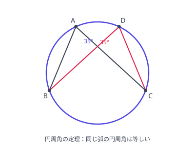

# 円の性質

- 円周角の定理：同弧所对的圆周角相等，直径所对的圆周角是直角。

图：对同一条弧 $BC$ 的两个圆周角 $\angle BAC$ 与 $\angle BDC$ 相等。
- 内接四角形：对角互补（対角の和は $180^\circ$）；外角等于内对角。
- 接弦定理（弦切角定理）：接線と弦の作る角は、その角の内部にある弧に対する円周角に等しい。
- 方べきの定理：点 $P$ 引两条直线交圆于 $A, B$ 与 $C, D$，则 $PA \cdot PB = PC \cdot PD$（$P$ 为切点时 $PT^2$）。
- 2つの円の位置関係：由圆心距 $d$ 与 $R \pm r$ 比较判定（外离/外切/相交/内切/内含）。

**演習：方べきの定理**

円の外部の点 $P$ から円に引いた2本の直線が円とそれぞれ $A$、$B$ および $C$、$D$ で交わり、$PA = 3$、$PB = 12$、$PC = 4$ のとき、$PD$ を求めよ。

??? example "思路・解答"
    **答案**

    $PD = 9$

    **思路**

    方べきの定理：$PA \cdot PB = PC \cdot PD$。

    **解答**

    $$3 \cdot 12 = 4 \cdot PD \quad\Longrightarrow\quad PD = 9$$

**演習：円周角**

円周上に4点 $A$、$B$、$C$、$D$ があり、$\angle BAC = 35^\circ$ のとき、$\angle BDC$ を求めよ（$D$ は $A$ と同じ側の弧上にあるとする）。

??? example "思路・解答"
    **答案**

    $35^\circ$

    **思路**

    对同一条弧 $BC$ 的圆周角相等。

    **解答**

    $$\angle BDC = \angle BAC = 35^\circ$$

## 易错点

- [ ] 方べきの定理で線分の積の組み合わせを取り違える（两段在同一直线上的才配对相乘）
