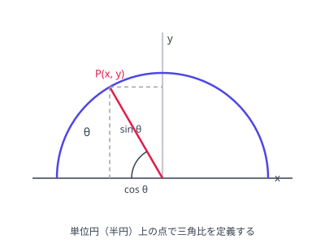

# 正弦・余弦・正接

## 鋭角の定義（直角三角形）

鋭角 $\theta$ に対して、直角三角形の辺の比で定義する。

- $\sin\theta = \dfrac{対辺（高さ）}{斜辺}$
- $\cos\theta = \dfrac{底辺}{斜辺}$
- $\tan\theta = \dfrac{対辺（高さ）}{底辺}$

相似な三角形なら比は同じなので、三角形の大きさによらず $\theta$ だけで決まる。

## $0^\circ$ から $180^\circ$ への拡張（座標による定義）

对 $0^\circ \le \theta \le 180^\circ$：$\sin\theta = \dfrac{y}{r}$、$\cos\theta = \dfrac{x}{r}$、$\tan\theta = \dfrac{y}{x}$（点 $(x, y)$ 在半径 $r$ 的半圆上）。钝角的三角比借此定义，$\sin(180^\circ - \theta) = \sin\theta$、$\cos(180^\circ - \theta) = -\cos\theta$。

图：以原点为圆心、半径 1 的半圆上的点 $P(x, y)$ 定义钝角的三角比：$\sin\theta = y$、$\cos\theta = x$。

原点を中心とする半径 $r$ の半円と、$x$ 軸の正の向きから測った角 $\theta$ の動径との交点 $(x, y)$ で定義するのが拡張の要点。これで鈍角でも $\sin$、$\cos$ が定義でき、$\cos$ は $x$ が負になるため負の値をとる。

- $\tan\theta = \dfrac{y}{x}$ は $\theta = 90^\circ$ のとき $x = 0$ となり**定義されない**（割り算の分母が 0）。
- 補角の関係：$\tan(180^\circ - \theta) = -\tan\theta$ も $\sin$、$\cos$ と同様に成り立つ。

## 符号のまとめ

| $\theta$ の範囲 | $\sin\theta$ | $\cos\theta$ | $\tan\theta$ |
| --- | --- | --- | --- |
| 鋭角（$0^\circ < \theta < 90^\circ$） | + | + | + |
| $90^\circ$ | $1$ | $0$ | なし（定義されない） |
| 鈍角（$90^\circ < \theta < 180^\circ$） | + | − | − |

## 覚えるべき値

| $\theta$ | $0^\circ$ | $30^\circ$ | $45^\circ$ | $60^\circ$ | $90^\circ$ | $120^\circ$ | $135^\circ$ | $150^\circ$ | $180^\circ$ |
| --- | --- | --- | --- | --- | --- | --- | --- | --- | --- |
| $\sin$ | 0 | 1/2 | √2/2 | √3/2 | 1 | √3/2 | √2/2 | 1/2 | 0 |
| $\cos$ | 1 | √3/2 | √2/2 | 1/2 | 0 | −1/2 | −√2/2 | −√3/2 | −1 |
| $\tan$ | 0 | 1/√3 | 1 | √3 | — | −√3 | −1 | −1/√3 | 0 |

値の出どころは 2 つの特別な三角形：$30^\circ, 60^\circ, 90^\circ$ の直角三角形（辺の比 $1 : 2 : \sqrt{3}$）と、$45^\circ, 45^\circ, 90^\circ$ の直角二等辺三角形（辺の比 $1 : 1 : \sqrt{2}$）。鈍角側の値は補角の関係で鋭角側から出すので、覚えるのは鋭角側だけで足りる。

## 易错点

- [ ] $\tan 90^\circ$ を 0 や無限大として扱う（定義されない）
- [ ] 鈍角の $\sin$ まで負になると思う（$\sin$ は $180^\circ$ まで正）
- [ ] 表の値を丸暗記して補角で出す手順を飛ばす（$120^\circ$ などは $180^\circ - 120^\circ = 60^\circ$ から出す）
