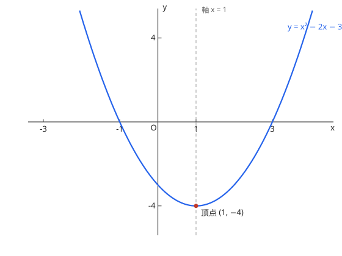

# 3. 2次関数

## シラバスとの対応

| 項目 | 内容 |
| --- | --- |
| 出題項目 | 3. 2次関数（数学I） |
| 細目 | (1) 2次関数とそのグラフ：①2次関数のグラフ ②2次関数の最大と最小 ③2次関数の決定　(2) 2次方程式と2次不等式：①2次方程式の解 ②2次関数のグラフと2次方程式 ③2次関数のグラフと2次不等式 |
| コース | コース1・コース2 共通。コース1 では配点の大きい中心的項目 |

## 1. グラフと平方完成

$$
y = ax^2 + bx + c = a\left(x + \frac{b}{2a}\right)^2 + \frac{4ac - b^2}{4a} \qquad (a \ne 0)
$$

頂点は $\left(-\dfrac{b}{2a},\ \dfrac{4ac - b^2}{4a}\right)$、軸は $x = -\dfrac{b}{2a}$。$a > 0$ で下に凸、$a < 0$ で上に凸。$y = ax^2$ のグラフの平行移動として捉えると、頂点と軸がそのまま移動量になる。

図：$y = x^2 - 2x - 3 = (x - 1)^2 - 4$ のグラフ。頂点 $(1, -4)$、軸 $x = 1$。

**2次関数の決定**：条件に応じて形を使い分ける。

- 頂点と 1 点が分かる → 頂点形 $y = a(x - p)^2 + q$
- $x$ 軸との交点（解 $\alpha, \beta$）と 1 点が分かる → $y = a(x - \alpha)(x - \beta)$
- 通る 3 点が分かる → 一般形 $y = ax^2 + bx + c$ に代入して連立

## 2. 最大・最小（定義域つき）

軸が定義域の中にあるかどうかで場合分けする。$f(x) = a(x - p)^2 + q$（$a > 0$）、定義域 $\alpha \leqq x \leqq \beta$ のとき：

- $p < \alpha$：最小値 $f(\alpha)$、最大値 $f(\beta)$
- $\alpha \leqq p \leqq \beta$：最小値 $f(p) = q$、最大値は軸から遠い方の端点
- $p > \beta$：最小値 $f(\beta)$、最大値 $f(\alpha)$

最大値は「軸から遠い端点」が原則。軸が定義域の中央よりどちら側かで決まる。

## 3. 2次方程式・判別式・2次不等式

$$
D = b^2 - 4ac
$$

| $D$ | $y = ax^2 + bx + c$ と $x$ 軸 | $ax^2 + bx + c = 0$ の実数解 |
| --- | --- | --- |
| $D > 0$ | 異なる 2 点で交わる | 異なる 2 実数解 |
| $D = 0$ | 1 点で接する | 重解 |
| $D < 0$ | 交わらない | 実数解なし |

2次不等式はグラフで解く：$a > 0$ のとき、$ax^2 + bx + c < 0$ の解は、$x$ 軸より下にある部分の $x$ の範囲（2 解 $\alpha < \beta$ に対して $\alpha < x < \beta$）。解の公式は

$$
x = \frac{-b \pm \sqrt{D}}{2a}
$$

## 例題（演習）

??? example "例題 1：定義域つきの最小値（文字を含む）"
    $a$ を実数とする。$f(x) = x^2 - 2ax + 3$（$0 \leqq x \leqq 2$）の最小値を $a$ を用いて表せ。

    **考え方**：平方完成して軸 $x = a$ の位置が定義域に対してどこにあるかで場合分けする。

    **解答**：$f(x) = (x - a)^2 + 3 - a^2$。

    - $a < 0$ のとき、最小値 $f(0) = 3$
    - $0 \leqq a \leqq 2$ のとき、最小値 $f(a) = 3 - a^2$
    - $a > 2$ のとき、最小値 $f(2) = 7 - 4a$

    **答え**：上記の通り（場合分けで答える）

??? example "例題 2：判別式と解の個数"
    2次方程式 $x^2 - 2mx + m + 2 = 0$ が異なる 2 つの実数解をもつような $m$ の値の範囲を求めよ。

    **考え方**：異なる 2 実数解 $\iff D > 0$。

    **解答**：

    $$
    \frac{D}{4} = m^2 - (m + 2) = m^2 - m - 2 = (m - 2)(m + 1) > 0
    $$

    **答え**：$m < -1$ または $m > 2$

??? example "例題 3：2次関数の決定"
    グラフの頂点が点 $(1, -4)$ で、点 $(0, -3)$ を通る 2次関数を求めよ。

    **考え方**：頂点が分かるので頂点形に置く。

    **解答**：$y = a(x - 1)^2 - 4$ と置くと、$(0, -3)$ を通るので $-3 = a - 4$、すなわち $a = 1$。

    **答え**：$y = (x - 1)^2 - 4 = x^2 - 2x - 3$

## よくあるミス

- [ ] 文字を含む最大・最小で、軸と定義域の位置による**場合分けをしない**
- [ ] 「実数解をもたない」は $D < 0$、「解が 1 つ（重解）」は $D = 0$ など、日本語の条件表現と $D$ の符号の対応を取り違える
- [ ] 頂点の $x$ 座標 $-\dfrac{b}{2a}$ の負号を落とす
- [ ] 2次不等式で、解を 2 解の「外側」と「内側」のどちらに取るか、グラフを見ずに決める

## 関連項目

- 基礎：[数と式](numbers.md)（平方完成は因数分解・解の公式と一体）
- 方程式の一般化は [いろいろな式](../course2/polynomials.md) へ
