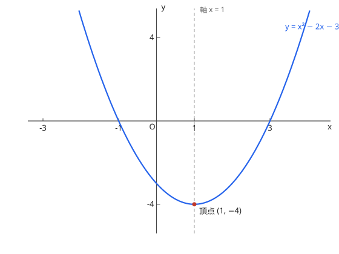

# 2次関数のグラフ

$y = ax^2 + bx + c$ 平方完成（平方完成）为 $y = a(x - p)^2 + q$ 后，顶点 $(p, q)$、轴 $x = p$。

顶点公式：$\left(-\dfrac{b}{2a},\ \dfrac{4ac - b^2}{4a}\right)$，轴 $x = -\dfrac{b}{2a}$。$a > 0$ 时向下凸（下に凸），$a < 0$ 时向上凸（上に凸）。

图：$y = (x-1)^2 - 4$，顶点 $(1, -4)$、对称轴 $x = 1$。

??? example "演習：平方完成と頂点"
    **问题**

    $y = x^2 - 2x - 3$ の頂点と軸を求めよ。

    **答案**

    頂点 $(1, -4)$、軸 $x = 1$

    **思路**

    平方完成：$x^2 - 2x = (x - 1)^2 - 1$。

    **解答**

    $$y = (x - 1)^2 - 4$$

    故顶点 $(1, -4)$，对称轴 $x = 1$（上图即此函数）。

## 易错点

- [ ] 平方完成时常数项处理错误（提出 $a$ 后再配）
- [ ] 「下に凸／上に凸」与 $a$ 的符号对应（$a>0$ 为下に凸＝开口向上，别按中文直觉读反）
