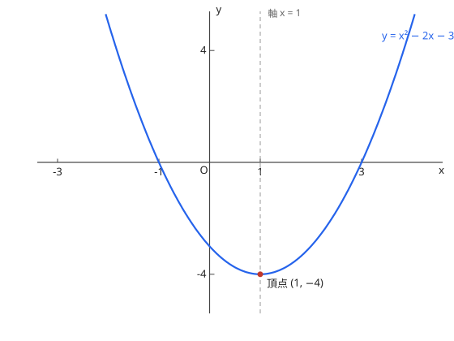

# 2次関数とグラフ

## 1. グラフと平方完成

$y = ax^2 + bx + c$ 平方完成（平方完成）为 $y = a(x - p)^2 + q$ 后，顶点 $(p, q)$、轴 $x = p$。

顶点公式：$\left(-\dfrac{b}{2a},\ \dfrac{4ac - b^2}{4a}\right)$，轴 $x = -\dfrac{b}{2a}$。$a > 0$ 时向下凸（下に凸），$a < 0$ 时向上凸（上に凸）。

图：$y = (x-1)^2 - 4$，顶点 $(1, -4)$、对称轴 $x = 1$。

## 2. 最大・最小

在给定区间内求最值：比较**顶点处的值**与**区间端点的值**。当定义域含参数（如轴或区间移动）时，要按顶点与区间的相对位置分情况（場合分け）。

## 3. 2次関数の決定

由顶点式（已知顶点）、一般式（已知 3 点）、交点式 $y = a(x - \alpha)(x - \beta)$（已知与 $x$ 轴交点）三种形式中选最省计算的一种，代入条件定系数。

??? example "演習：平方完成と頂点"
    **问题**

    $y = x^2 - 2x - 3$ の頂点と軸を求めよ。

    **答案**

    頂点 $(1, -4)$、軸 $x = 1$

    **思路**

    平方完成：$x^2 - 2x = (x - 1)^2 - 1$。

    **解答**

    $$y = (x - 1)^2 - 4$$

    故顶点 $(1, -4)$，对称轴 $x = 1$（上图即此函数）。

??? example "演習：最大・最小（場合分け）"
    **问题**

    $a > 0$ のとき、関数 $y = x^2 - 2ax$（$0 \le x \le 2$）の最小値を求めよ。

    **答案**

    $0 < a < 1$ のとき $-a^2$；$a \ge 1$ のとき $4 - 4a$

    **思路**

    顶点在 $x = a$。分顶点落在区间内（$a < 1$，注意还要 $a \le 2$，此处 $a<1$ 已含）与区间外（$a \ge 1$ 时函数在区间内单调，代入端点）两种情况。

    **解答**

    平方完成得 $y = (x - a)^2 - a^2$。

    - $0 < a < 1$：顶点在区间内，最小值 $= -a^2$（$x = a$ 时）
    - $a \ge 1$：在 $[0, 2]$ 上单调递增，最小值在 $x = 2$：$4 - 4a$

## 易错点

- [ ] 平方完成时常数项处理错误（提出 $a$ 后再配）
- [ ] 含参最值题的分情况临界点取错（顶点=端点的位置）
- [ ] 「下に凸／上に凸」与 $a$ 的符号对应（$a>0$ 为下に凸＝开口向上，别按中文直觉读反）
