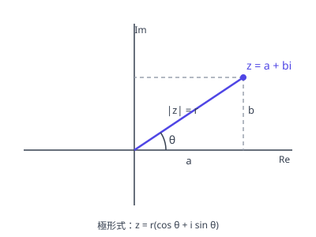

# 複素数の極形式

複素数を「原点からの距離 $r$」と「実軸からの角 $\theta$」で表す書き方が極形式（极形式）：

图：$z = a + bi$ 的极形式读法——模 $r = \sqrt{a^2 + b^2}$ 是到原点的距离，辐角 $\theta$ 与实轴的夹角。

$$z = r(\cos\theta + i\sin\theta), \qquad r = |z|,\ \theta = \arg z$$

$a + bi$ の形が座標での位置を表すのに対し、極形式は「どれだけ離れて、どの向きか」を表す。乗除・累乗・回転は極形式の方が圧倒的に扱いやすい。ここで $r = |z| \ge 0$ で、$\theta$ は主値 $-\pi < \theta \le \pi$ で取るのが約束。

## 極形式の求め方

1. $r = \sqrt{a^2 + b^2}$ を求める
2. $\cos\theta = \dfrac{a}{r}$、$\sin\theta = \dfrac{b}{r}$ の**両方**を満たす $\theta$ を主値の範囲で決める（片方だけでは象限が確定しない。符号の組で象限を見る）
3. $r(\cos\theta + i\sin\theta)$ の形に書く

逆に極形式から $a + bi$ の形へは、$\cos\theta$、$\sin\theta$ の値を代入して展開するだけ。

## 乗法・除法

$z_1 = r_1(\cos\theta_1 + i\sin\theta_1)$、$z_2 = r_2(\cos\theta_2 + i\sin\theta_2)$ に対して、乘除在极形式下变为「模相乘、角相加」：

- 積：$z_1 z_2 = r_1 r_2 \left\{\cos(\theta_1 + \theta_2) + i\sin(\theta_1 + \theta_2)\right\}$
- 商：$\dfrac{z_1}{z_2} = \dfrac{r_1}{r_2} \left\{\cos(\theta_1 - \theta_2) + i\sin(\theta_1 - \theta_2)\right\}$

累乗は積の繰り返しであり、[ド・モアブルの定理](demoivre.md) に一般化される。共役は $\bar{z} = r(\cos\theta - i\sin\theta) = r\left\{\cos(-\theta) + i\sin(-\theta)\right\}$ と、偏角の符号だけが反転する。

## 回転との対応

乘以单位模的复数即旋转：$w = \cos\theta + i\sin\theta$（$|w| = 1$）を掛けることは、原点のまわりに角 $\theta$ だけ回転させることに等しい。絶対値 $r$ の複素数を掛ければ「回転 + $r$ 倍の拡大・縮小」（回転相似変換）になる。

一般の点 $\alpha$ のまわりの回転は、$\alpha$ を原点にずらして回転し、戻す：$z' - \alpha = (\cos\theta + i\sin\theta)(z - \alpha)$。図形の回転（正三角形・正方形の頂点の決定など）は、辺に対応する複素数へ $\cos 60^\circ + i\sin 60^\circ$ のような回転因子を掛ける形に帰着させる。具体的な図形への応用は [複素数と図形](figures.md) を参照。

## 易错点

- [ ] 偏角を $\cos\theta$ だけ、または $\sin\theta$ だけで決めて象限を誤る（定偏角要用两个式子的符号组合判断象限）
- [ ] $r$ に負の値を許して極形式と書いてしまう（极形式要求 $r \ge 0$；出现负号时应把符号吸收到偏角里，即 $\theta$ 加 $\pi$）
- [ ] 積の偏角は和・商の偏角は差という対応を逆にする（乘法角度相加、除法角度相减，写之前先在图上确认旋转方向）
