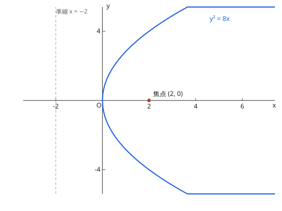
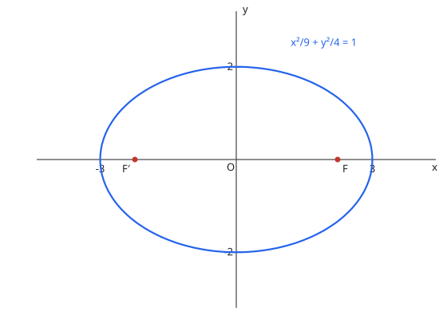
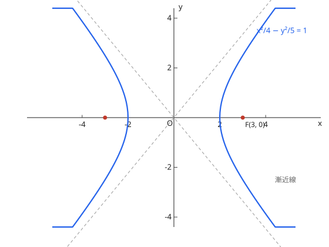

# 16. 式と曲線

## 与考纲的对应

| 项目 | 内容 |
| --- | --- |
| 考纲项目 | 16. 式と曲線（数学C） |
| 细目 | (1) 2次曲線（放物線、楕円、双曲線）　(2) 媒介変数による表示　(3) 極座標と極方程式 |
| 适用课程 | 仅 Course 2 |

## 1. 2次曲線

**放物線**（抛物线，焦点 $(p, 0)$、準線 $x = -p$）：

$$
y^2 = 4px
$$

定义是「到焦点与到準線距离相等的点的軌跡」，能按轨迹定义自己推导出来很重要。

图：放物線 $y^2 = 8x$。焦点 $(2, 0)$，準線 $x = -2$。

**楕円**（椭圆，$a > b > 0$）：

$$
\frac{x^2}{a^2} + \frac{y^2}{b^2} = 1, \qquad \text{焦点 } (\pm\sqrt{a^2 - b^2}, 0), \quad \text{長軸 } 2a, \ \text{短軸 } 2b
$$

定义是「到两焦点距离之和为定值（$= 2a$）」。

图：楕円 $\dfrac{x^2}{9} + \dfrac{y^2}{4} = 1$。焦点是 $(\pm\sqrt{5}, 0)$。

**双曲線**（双曲线）：

$$
\frac{x^2}{a^2} - \frac{y^2}{b^2} = 1, \qquad \text{焦点 } (\pm\sqrt{a^2 + b^2}, 0), \quad \text{漸近線 } y = \pm\frac{b}{a}x
$$

定义是「到两焦点距离之差为定值（$= 2a$）」。注意焦点公式里楕円是 $a^2 - b^2$、双曲線是 $a^2 + b^2$，符号别记反。

图：双曲線 $\dfrac{x^2}{4} - \dfrac{y^2}{5} = 1$。焦点是 $(\pm 3, 0)$，虚线是漸近線 $y = \pm\dfrac{\sqrt{5}}{2}x$。

## 2. 媒介変数による表示

用 $x = f(t)$、$y = g(t)$ 表示的曲线，消去参数 $t$ 就能回到 $x$、$y$ 的方程。圆 $x^2 + y^2 = a^2$ 的表示 $x = a\cos\theta$、$y = a\sin\theta$ 是代表例。消去后**变量的取值范围**可能附带限制，别漏。

## 3. 極座標と極方程式

以極 $O$、始線 $Ox$ 为基准，点 $P$ 用 $(r, \theta)$ 表示。与直交座標的关系是

$$
x = r\cos\theta, \qquad y = r\sin\theta, \qquad r = \sqrt{x^2 + y^2}
$$

极方程式看不出图形时，两边乘 $r$ 等变形化成直交座標的方程，往往就清楚了（见例题 3）。

## 例题（演习）

??? example "例题 1：放物線の焦点と準線"
    放物線 $y^2 = 8x$ の焦点と準線を求めよ。

    **思路**：与标准形 $y^2 = 4px$ 对照，由 $4p = 8$ 读出 $p$。

    **解答**：$p = 2$。焦点是 $(2, 0)$，準線是 $x = -2$。

    **答案**：焦点 $(2, 0)$，準線 $x = -2$

??? example "例题 2：楕円の焦点"
    楕円 $\dfrac{x^2}{9} + \dfrac{y^2}{4} = 1$ の焦点と長軸・短軸の長さを求めよ。

    **思路**：读出 $a^2 = 9$、$b^2 = 4$，焦点在 $\pm\sqrt{a^2 - b^2}$。

    **解答**：焦点是 $(\pm\sqrt{5}, 0)$。長軸长 $2a = 6$，短軸长 $2b = 4$。

    **答案**：焦点 $(\pm\sqrt{5}, 0)$，長軸 $6$，短軸 $4$

??? example "例题 3：極方程式を直交座標に直す"
    極方程式 $r = 2\cos\theta$ の表す図形を求めよ。

    **思路**：两边乘 $r$，用 $r^2 = x^2 + y^2$、$r\cos\theta = x$ 替换。

    **解答**：由 $r^2 = 2r\cos\theta$ 得 $x^2 + y^2 = 2x$，即 $(x - 1)^2 + y^2 = 1$。

    **答案**：中心 $(1, 0)$、半径 $1$ 的圆

## 易错点

- [ ] 楕円与双曲線的焦点公式记反（$a^2 - b^2$ 与 $a^2 + b^2$）
- [ ] 消去参数后不查变量的取值范围
- [ ] 极方程式变形中用 $r$ 作除数时漏掉 $r = 0$（極点）的处理
- [ ] 双曲線漸近線的斜率 $\pm\dfrac{b}{a}$ 方向写反

## 相关条目

- 前提：[図形と方程式](geometry-equation.md)、[ベクトル](vector.md)
- 轨迹的思路与 [図形の性質](../course1/geometry.md) 相通
