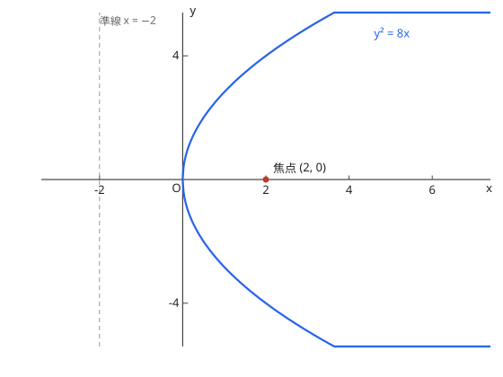
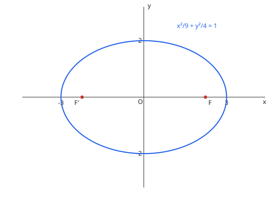
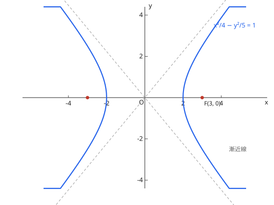

# 2次曲線

| 曲線 | 標準形 | 焦点・準線 | 特徴 |
| --- | --- | --- | --- |
| 放物線（抛物线） | $y^2 = 4px$ | 焦点 $(p, 0)$、準線 $x = -p$ | 到焦点与准线距离相等 |
| 楕円（椭圆） | $\dfrac{x^2}{a^2} + \dfrac{y^2}{b^2} = 1$（$a > b$） | 焦点 $(\pm\sqrt{a^2 - b^2}, 0)$ | 到两焦点距离和 $= 2a$；離心率 $e = \dfrac{\sqrt{a^2-b^2}}{a} < 1$ |
| 双曲線 | $\dfrac{x^2}{a^2} - \dfrac{y^2}{b^2} = 1$ | 焦点 $(\pm\sqrt{a^2 + b^2}, 0)$ | 到两焦点距离差 $= 2a$；漸近線 $y = \pm\dfrac{b}{a}x$；$e > 1$ |

图：抛物线 $y^2 = 4x$，焦点 $(1, 0)$、準線 $x = -1$。

图：椭圆 $\dfrac{x^2}{9} + \dfrac{y^2}{4} = 1$，焦点 $(\pm\sqrt{5}, 0)$。

图：双曲线 $\dfrac{x^2}{4} - \dfrac{y^2}{5} = 1$（红）与渐近线（虚线）。

**演習：楕円**

楕円 $\dfrac{x^2}{9} + \dfrac{y^2}{4} = 1$ の焦点の座標を求めよ。

??? example "思路・解答"
    **答案**

    $(\sqrt{5}, 0)$ と $(-\sqrt{5}, 0)$

    **思路**

    $a^2 = 9$、$b^2 = 4$，焦点在长轴（$x$ 轴）上，距离 $c = \sqrt{a^2 - b^2}$。

    **解答**

    $$c = \sqrt{9 - 4} = \sqrt{5} \quad\Longrightarrow\quad (\pm\sqrt{5}, 0)$$

**演習：放物線**

放物線 $y^2 = 8x$ の焦点と準線を求めよ。

??? example "思路・解答"
    **答案**

    焦点 $(2, 0)$、準線 $x = -2$

    **思路**

    与标准形 $y^2 = 4px$ 对照：$4p = 8$，$p = 2$。

    **解答**

    $$p = 2 \quad\Longrightarrow\quad \text{焦点 } (2, 0)、\text{準線 } x = -2$$

## 易错点

- [ ] 楕円と双曲線で焦点距離の式の符号を取り違える（椭圆减、双曲线加）
- [ ] 長軸が $y$ 軸側のとき焦点の向き（长轴在 y 轴时焦点位置随之换向）
