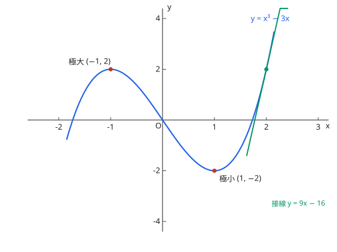

# 19. 微分法

## シラバスとの対応

| 項目 | 内容 |
| --- | --- |
| 出題項目 | 19. 微分法（数学II・数学III） |
| 細目 | (1) 導関数：微分係数と導関数、関数の和・差・積・商の導関数、合成関数の導関数、逆関数の導関数、三角関数・指数関数・対数関数の導関数、第 $n$ 次導関数　(2) 導関数の応用：①接線 ②関数の値の増減 ③関数の最大と最小 ④関数のグラフ ⑤速度、加速度 ⑥近似値 |
| コース | コース2 のみ。コース2 全体で最も配点の大きい項目群の 1 つ |

## 1. 導関数の計算

$$
f'(x) = \lim_{h \to 0} \frac{f(x + h) - f(x)}{h}
$$

$$
(x^n)' = nx^{n-1}, \quad (\sin x)' = \cos x, \quad (\cos x)' = -\sin x, \quad (e^x)' = e^x, \quad (a^x)' = a^x \log a, \quad (\log x)' = \frac{1}{x}, \quad (\log_a x)' = \frac{1}{x \log a}
$$

$$
\{f(x)g(x)\}' = f'(x)g(x) + f(x)g'(x), \qquad \left\{\frac{f(x)}{g(x)}\right\}' = \frac{f'(x)g(x) - f(x)g'(x)}{\{g(x)\}^2}
$$

**合成関数の導関数**：$\{f(g(x))\}' = f'(g(x))\,g'(x)$。**逆関数の導関数**：$\dfrac{dx}{dy} = \dfrac{1}{\frac{dy}{dx}}$。

**第 $n$ 次導関数**の例：$(e^x)^{(n)} = e^x$、$(\sin x)^{(n)} = \sin\left(x + \dfrac{n\pi}{2}\right)$。

## 2. 接線と増減・グラフ

曲線 $y = f(x)$ 上の点 $(a, f(a))$ における接線は $y - f(a) = f'(a)(x - a)$。法線は接線に垂直な直線。

$f'(x) > 0$ の区間では $f$ は増加、$f'(x) < 0$ では減少。$f'(x) = 0$ となる点の前後で符号が変わるところが極値であり、**変わらない点は極値ではない**。グラフの概形は、増減表（$f'$, $f$ の符号と値）に $f''$ による凹凸を加えて描く。

図：$y = x^3 - 3x$ のグラフ。極大 $(-1, 2)$、極小 $(1, -2)$、点 $x = 2$ における接線 $y = 9x - 16$（例題 2・3 と同じ関数）。

## 3. 速度・加速度と近似値

直線上の点の座標 $x = f(t)$ に対して、速度は $v = f'(t)$、加速度は $a = v'(t) = f''(t)$。

**近似値**：$f(a + h) \approx f(a) + f'(a)h$（$h$ が小さいとき）。接線による 1 次近似である。

## 例題（演習）

??? example "例題 1：合成関数の微分"
    $y = (2x + 1)^3$ を微分せよ。

    **考え方**：外側の関数 $u^3$ と内側の関数 $u = 2x + 1$ の導関数の積。

    **解答**：$y' = 3(2x + 1)^2 \cdot 2 = 6(2x + 1)^2$。

    **答え**：$y' = 6(2x + 1)^2$

??? example "例題 2：接線"
    曲線 $y = x^3 - 3x$ の点 $x = 2$ における接線の方程式を求めよ。

    **考え方**：$f(2)$ と $f'(2)$ を計算して接線の式に代入する。

    **解答**：$y' = 3x^2 - 3$、$f'(2) = 9$、$f(2) = 2$。接線は $y - 2 = 9(x - 2)$。

    **答え**：$y = 9x - 16$

??? example "例題 3：極値"
    $f(x) = x^3 - 3x$ の極値を求めよ。

    **考え方**：$f'(x) = 0$ の前後の符号を調べる。

    **解答**：$f'(x) = 3(x - 1)(x + 1)$。$x = -1$ で $f'$ が $+$ から $-$ に変わるので極大値 $f(-1) = 2$。$x = 1$ で $-$ から $+$ に変わるので極小値 $f(1) = -2$。

    **答え**：極大値 $2$（$x = -1$）、極小値 $-2$（$x = 1$）

??? example "例題 4：近似値"
    $\sqrt{4.02}$ の近似値を求めよ。

    **考え方**：$f(x) = \sqrt{x}$ の $x = 4$ における 1 次近似を使う。$f'(x) = \dfrac{1}{2\sqrt{x}}$、$f'(4) = \dfrac{1}{4}$。

    **解答**：$\sqrt{4.02} \approx f(4) + f'(4) \times 0.02 = 2 + \dfrac{1}{4} \times 0.02 = 2.005$。

    **答え**：約 $2.005$

## よくあるミス

- [ ] $f'(x) = 0$ の点をすべて極値だと思い込む（符号の変化が必要。$y = x^3$ の $x = 0$ が反例）
- [ ] 合成関数の微分で内側の導関数 $g'(x)$ を掛け忘れる
- [ ] 商の導関数で分子の順序（$f'g - fg'$）を取り違える
- [ ] 近似式を $h$ が大きくない場面で使う

## 関連項目

- 前提：[極限](limits.md)、[関数](functions.md)
- 次の項目：[積分法](integration.md)
