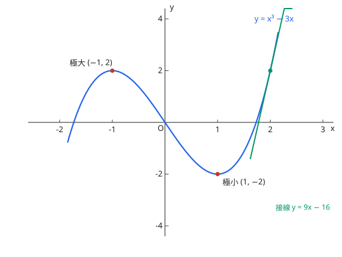

# 導関数の応用

## 1. 接線

点 $(a, f(a))$ 处：$y = f'(a)(x - a) + f(a)$。法线斜率为 $-\dfrac{1}{f'(a)}$。

## 2. 関数の値の変化・最大と最小・グラフ

- $f' > 0$ 区间递增、$f' < 0$ 递减；$f'$ 变号点是极值点（極大・極小）
- 画图像流程：定义域 → $f'$ 符号表（増減表）→ 极值与渐近线 → 凹凸（二阶导数 $f''$ 的符号）与拐点（変曲点）

图：$y = x^3 - 3x$，极大 $(-1, 2)$、极小 $(1, -2)$，红线为 $x = 2$ 处的切线。

## 3. 速度・加速度と近似式

位置 $x(t)$ 的导数是速度、二阶导数是加速度。近似式：$f(a + h) \approx f(a) + f'(a)h$（$h$ 很小时），如 $\sqrt{4.02} \approx 2 + \dfrac{1}{4}(0.02)$。

??? example "演習：極値"
    **问题**

    $f(x) = x^3 - 3x$ の極値を求めよ。

    **答案**

    $x = -1$ で極大値 $2$、$x = 1$ で極小値 $-2$

    **思路**

    $f'(x) = 3x^2 - 3 = 0$ 得 $x = \pm 1$；作 $f'$ 符号表确认变号方向（上图即此函数）。

    **解答**

    | $x$ | $\cdots$ | $-1$ | $\cdots$ | $1$ | $\cdots$ |
    | --- | --- | --- | --- | --- | --- |
    | $f'$ | + | 0 | − | 0 | + |
    | $f$ | ↗ | 極大 2 | ↘ | 極小 −2 | ↗ |

??? example "演習：接線"
    **问题**

    曲線 $y = x^2$ 上の点 $(1, 1)$ における接線の方程式を求めよ。

    **答案**

    $y = 2x - 1$

    **思路**

    斜率是 $y' = 2x$ 在 $x = 1$ 处的值 2，过点 $(1, 1)$ 写点斜式。

    **解答**

    $$y - 1 = 2(x - 1) \quad\Longrightarrow\quad y = 2x - 1$$

??? example "演習：微分係数の定義"
    **问题**

    定義に従って、$f(x) = x^2$ の $x = 1$ における微分係数を求めよ。

    **答案**

    $2$

    **思路**

    直接用差商定义求极限（不要用公式，要按定义的步骤写）。

    **解答**

    $$f'(1) = \lim_{h \to 0} \frac{(1 + h)^2 - 1}{h} = \lim_{h \to 0} \frac{2h + h^2}{h} = \lim_{h \to 0} (2 + h) = 2$$

## 易错点

- [ ] 極値点と $f' = 0$ の点は同値ではない（変号しない点は極値でない，导数为 0 而不变号的点不是极值点，如 $x^3$ 的原点）
- [ ] 最大値・最小値は閉区間の端点も候補（闭区间最值别忘端点）
- [ ] 近似式は $h$ が小さい前提（近似式只在增量很小时可用）
