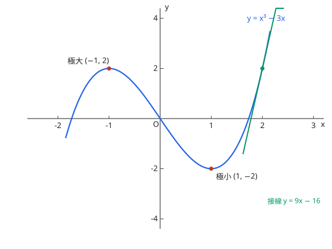

# 関数のグラフ

関数のグラフを描く問題は、手順を固定してチェックリストとして処理すると漏れがなくなる。

## 描画手順（チェックリスト）

1. **定義域**を確認する（分母 ≠ 0、根号内 ≧ 0、真数 > 0 など）。定義域の外は描かない。
2. **対称性**を調べる：$f(-x) = f(x)$ なら $y$ 軸対称（偶関数）、$f(-x) = -f(x)$ なら原点対称（奇関数）。対称性があれば調べる範囲を半分にできる。
3. **$f'(x)$ を求め、増減表を作る**：$f' = 0$ の点と $f'$ が存在しない点を境に符号を調べ、増減と極値（極大・極小）を確定する。
4. **$f''(x)$ で凹凸を調べる**：$f'' > 0$ の区間は下に凸、$f'' < 0$ の区間は上に凸。$f''$ の符号が変わる点が**変曲点**である。
5. **漸近線**を確認する：
    - 鉛直漸近線：$x \to a$ で $|f(x)| \to \infty$ となる $a$（分数関数では分母 = 0 の点が候補）
    - 水平漸近線：$x \to \pm\infty$ で $f(x)$ がある有限値に近づくとき、その値が漸近線になる
    - 斜め漸近線：分数関数で分子の次数が分母より 1 だけ大きいとき、割り算の商が斜め漸近線になる
6. **切片と代表点**（$x = 0$ のときの値、$f(x) = 0$ の点、極値・変曲点の座標）をそろえる。
7. 1〜6 をつないで描く。増減表とグラフの形が一致しているか最後に照合する。

## 増減表に書くもの

$x$ の行（境界点）、$f'$ の行（符号と 0）、$f''$ の行（必要な場合）、$f$ の行（↗↘ の矢印と極値・変曲点の値）。グラフ問題は増減表の正しさに大きく依存するので、表を省略しない。

图：$y = x^3 - 3x$，极大 $(-1, 2)$、极小 $(1, -2)$，红线为 $x = 2$ 处的切线。3 次関数は変曲点に関して点対称になることが多い（この例では原点）。

## 易错点

- [ ] $f'(x) = 0$ の点をすべて極値だと思い込む（符号が変わらなければ極値ではない；[関数の値の変化と最大・最小](increase-decrease.md) 参照）
- [ ] 漸近線の確認漏れ、特に分数関数の水平・斜め漸近線
- [ ] 定義域の外側までグラフを伸ばして描く
- [ ] 変曲点の条件を $f''(x) = 0$ だけだと思い込む（符号の変化が必要）
