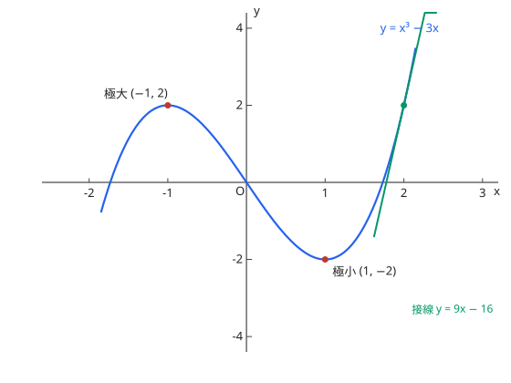

# 関数の値の変化と最大・最小

- $f' > 0$ 区间递增、$f' < 0$ 递减；$f'$ 变号点是极值点（極大・極小）

图：$y = x^3 - 3x$ 的増減：极大 $(-1, 2)$、极小 $(1, -2)$。

**演習：極値**

$f(x) = x^3 - 3x$ の極値を求めよ。

??? example "思路・解答"
    **答案**

    $x = -1$ で極大値 $2$、$x = 1$ で極小値 $-2$

    **思路**

    $f'(x) = 3x^2 - 3 = 0$ 得 $x = \pm 1$；作 $f'$ 符号表确认变号方向（上图即此函数）。

    **解答**

    | $x$ | $\cdots$ | $-1$ | $\cdots$ | $1$ | $\cdots$ |
    | --- | --- | --- | --- | --- | --- |
    | $f'$ | + | 0 | − | 0 | + |
    | $f$ | ↗ | 極大 2 | ↘ | 極小 −2 | ↗ |

## 易错点

- [ ] 極値点と $f' = 0$ の点は同値ではない（変号しない点は極値でない，导数为 0 而不变号的点不是极值点，如 $x^3$ 的原点）
- [ ] 最大値・最小値は閉区間の端点も候補（闭区间最值别忘端点）
