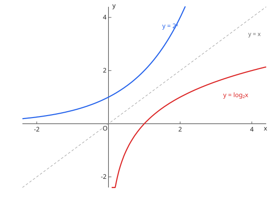

# 10. 指数関数・対数関数

## シラバスとの対応

| 項目 | 内容 |
| --- | --- |
| 出題項目 | 10. 指数関数・対数関数（数学II） |
| 細目 | (1) 指数関数：①指数の拡張 ②指数関数とそのグラフ　(2) 対数関数：①対数の性質 ②対数関数とそのグラフ ③常用対数 |
| コース | コース2 のみ |

## 1. 指数の拡張と指数関数

$$
a^m a^n = a^{m+n}, \qquad (a^m)^n = a^{mn}, \qquad a^0 = 1, \qquad a^{-n} = \frac{1}{a^n}, \qquad a^{\frac{m}{n}} = \sqrt[n]{a^m} \quad (a > 0)
$$

$y = a^x$（$a > 0$, $a \ne 1$）は点 $(0, 1)$ を通り、$a > 1$ で単調増加、$0 < a < 1$ で単調減少。定義域は実数全体、値域は正の実数全体。

## 2. 対数と対数関数

$$
a^x = b \iff x = \log_a b \qquad (a > 0,\ a \ne 1,\ b > 0)
$$

$$
\log_a xy = \log_a x + \log_a y, \qquad \log_a \frac{x}{y} = \log_a x - \log_a y, \qquad \log_a x^n = n \log_a x, \qquad \log_a b = \frac{\log_c b}{\log_c a} \ \text{（底の変換）}
$$

$y = \log_a x$ は $y = a^x$ と直線 $y = x$ に関して対称で、点 $(1, 0)$ を通る。底が $0 < a < 1$ のとき単調減少であり、**対数不等式では不等号の向きが変わる**。

図：$y = 2^x$ と $y = \log_2 x$ は直線 $y = x$ に関して対称である（逆関数の関係、[関数](functions.md) 参照）。

## 3. 常用対数

$\log_{10}$ を使うと大きな数の桁数と最高位の数が分かる：$N$ の桁数は $\lfloor \log_{10} N \rfloor + 1$。$\log_{10} 2 = 0.3010$、$\log_{10} 3 = 0.4771$ が頻出の近似値。

## 例題（演習）

??? example "例題 1：指数方程式"
    $2^{2x} - 3 \cdot 2^x + 2 = 0$ を解け。

    **考え方**：$t = 2^x > 0$ と置くと $t$ の 2 次方程式になる。

    **解答**：$t^2 - 3t + 2 = (t - 1)(t - 2) = 0$ より $t = 1, 2$。$2^x = 1$ から $x = 0$、$2^x = 2$ から $x = 1$。

    **答え**：$x = 0, 1$

??? example "例題 2：対数方程式"
    $\log_2 (x - 1) + \log_2 (x + 1) = 3$ を解け。

    **考え方**：先に真数条件 $x - 1 > 0$ かつ $x + 1 > 0$、すなわち $x > 1$ を確認する。

    **解答**：和をまとめると $\log_2 (x^2 - 1) = 3$、$x^2 - 1 = 8$、$x = \pm 3$。真数条件 $x > 1$ を満たすのは $x = 3$ のみ。

    **答え**：$x = 3$

??? example "例題 3：常用対数"
    $2^{20}$ は何桁の数か。ただし $\log_{10} 2 = 0.3010$ とする。

    **考え方**：$\log_{10} 2^{20}$ の整数部分 + 1 が桁数。

    **解答**：$\log_{10} 2^{20} = 20 \times 0.3010 = 6.020$。整数部分は $6$。

    **答え**：$7$ 桁

## よくあるミス

- [ ] 対数方程式・不等式で真数条件（真数 > 0）の確認を最後までしない（不適解を取り込む）
- [ ] 底が 1 より小さいとき、不等号の向きを変え忘れる
- [ ] $(\log_a x)^2$ と $\log_a x^2$ を混同する（後者は $2 \log_a |x|$ の話であり、同値ではない）
- [ ] 負の指数・分数指数の計算で、底が正である前提を無視する

## 関連項目

- 発展：[関数](functions.md)（逆関数としての対数関数）、[極限](limits.md)
- 微分すると [微分法](differentiation.md) で再登場する
