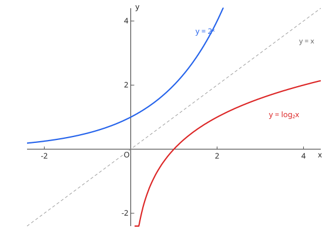

# 対数関数とそのグラフ

$y = \log_a x$ 是 $y = a^x$ 的反函数，图像关于直线 $y = x$ 对称：定义域 $x > 0$、恒过 $(1, 0)$；$a > 1$ 递增、$0 < a < 1$ 递减。对数不等式除了比较真数，还要**同时保证真数 > 0**。

图：$y = 2^x$ 与 $y = \log_2 x$ 关于 $y = x$ 对称。

## 指数関数との対応

反関数なので、指数関数の性質を裏返すと対数関数の性質になる：

| | $y = a^x$ | $y = \log_a x$ |
| --- | --- | --- |
| 定義域 | 実数全体 | $x > 0$ |
| 値域 | $y > 0$ | 実数全体 |
| 漸近線 | $y = 0$（$x$ 軸） | $x = 0$（$y$ 軸） |
| 通る点 | $(0, 1)$ | $(1, 0)$ |
| 増減（$a > 1$） | 増加 | 増加 |

グラフは $y$ 軸に限りなく近づくが交わらない・触れない（真数が $0$ 以下では定義されない）。$0 < a < 1$ のときは $a > 1$ のグラフを $x$ 軸に関して折り返した形で、減少関数になる。

## 底の違いと平行移動

- 底の変換：$\log_a x = \dfrac{\log_b x}{\log_b a}$ なので、異なる底のグラフは上下方向の定数倍の関係にある。特に $y = \log_{1/a} x = -\log_a x$ で、底が逆数のグラフ同士は $x$ 軸対称。
- 平行移動：$y = \log_a (x - p) + q$ 是 $y = \log_a x$ を $x$ 方向に $p$、$y$ 方向に $q$ 移動したもので、定義域は $x > p$、漸近線は $x = p$、通る点は $(p + 1, q)$。移動量は「定義域と漸近線がどれだけずれるか」で読む。

## 対数方程式・不等式の解法手順

1. **真数条件を先に書く**：全ての対数の真数が $> 0$ になる範囲を最初に確定する（これが答えの定義域になる）
2. 底をそろえる：底の変換公式で同じ底に統一し、$\log_a(\text{真数})$ の形にまとめる
3. 方程式なら真数同士を等しく置く；不等式なら単調性で真数の大小に直す（$a > 1$ では向き不変、$0 < a < 1$ では**向きが逆転**する）
4. 得られた解と 1. の真数条件との共通部分を取る

大小比較の問題（$\log_2 3$ と $\log_4 9$ など）も、底をそろえて真数を比べるか、$\log$ を外せる形に変形するのが基本線。

## 易错点

- [ ] 真数条件（真数＞0）を最後まで落とさない（解对数方程/不等式全程保留真数 > 0，最后一步与定义域取交集，漏这一步会多出增根）
- [ ] 底が $0 < a < 1$ のとき不等号の向きを逆にし忘れる（底小于 1 时函数递减，脱对数时不等号必须反转）
- [ ] グラフが $y$ 軸と交わると描いてしまう（对数曲线以 $y$ 轴为渐近线，只在 $x > 0$ 一侧存在，作图时定义域优先）
