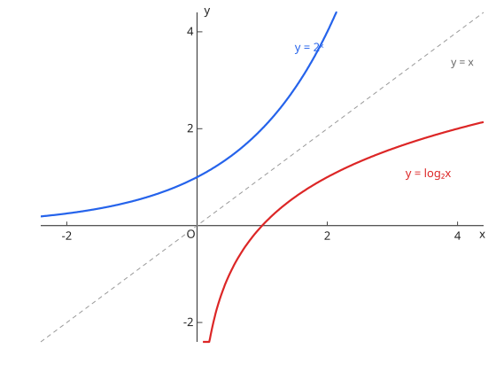

# 対数関数

## 1. 対数の性質

$a^p = M \iff \log_a M = p$（$a > 0, a \ne 1, M > 0$）。

- $\log_a MN = \log_a M + \log_a N$
- $\log_a \dfrac{M}{N} = \log_a M - \log_a N$
- $\log_a M^r = r \log_a M$
- 底の変換公式（换底公式）：$\log_a b = \dfrac{\log_c b}{\log_c a}$

## 2. 対数関数とそのグラフ

$y = \log_a x$ 是 $y = a^x$ 的反函数，图像关于直线 $y = x$ 对称：定义域 $x > 0$、恒过 $(1, 0)$；$a > 1$ 递增、$0 < a < 1$ 递减。对数不等式除了比较真数，还要**同时保证真数 > 0**。

图：$y = 2^x$ 与 $y = \log_2 x$ 关于 $y = x$ 对称。

## 3. 常用対数

$\log_{10}$ 用于估算位数与最高位数字：$M$ 的位数 $= \lfloor \log_{10} M \rfloor + 1$。

??? example "演習：対数の計算"
    **问题**

    $\log_{10} 2 + \log_{10} 5$ の値を求めよ。

    **答案**

    $1$

    **思路**

    和化积：$\log_{10}(2 \times 5) = \log_{10} 10$。

    **解答**

    $$\log_{10} 2 + \log_{10} 5 = \log_{10} 10 = 1$$

??? example "演習：常用対数と桁数"
    **问题**

    $\log_{10} 2 = 0.3010$ として、$2^{30}$ は何桁の数か。

    **答案**

    10 桁

    **思路**

    位数由常用对数的整数部分决定：$\log_{10} 2^{30} = 30 \times 0.3010 = 9.03$，整数部分 9 → 10 位数。

    **解答**

    $$\log_{10} 2^{30} = 9.03 \quad\Longrightarrow\quad 10^{9} \le 2^{30} < 10^{10} \quad\Longrightarrow\quad 10 \text{ 桁}$$

## 易错点

- [ ] 真数条件（真数＞0）を最後まで落とさない（解对数方程/不等式全程保留真数 > 0）
- [ ] $\log_a(M + N)$ は分解できない（对数不能拆和的对数）
- [ ] 桁数は「整数部分＋1」（位数 = 整数部分 + 1）
