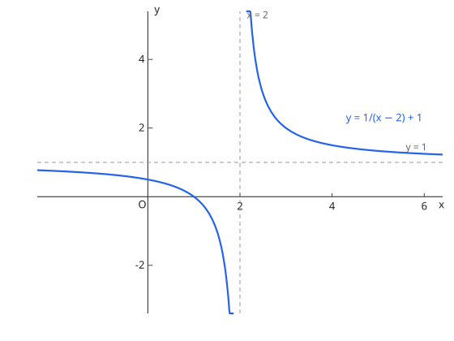
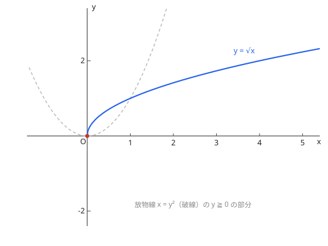
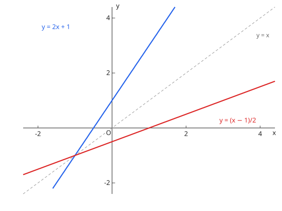

# 17. 関数

## 与考纲的对应

| 项目 | 内容 |
| --- | --- |
| 考纲项目 | 17. 関数（数学III） |
| 细目 | (1) 分数関数と無理関数　(2) 逆関数と合成関数 |
| 适用课程 | 仅 Course 2，是 [極限](limits.md)、[微分法](differentiation.md) 的前提 |

## 1. 分数関数と無理関数

**分数関数** $y = \dfrac{k}{x - p} + q$（$k \ne 0$）的图像，是 $y = \dfrac{k}{x}$ 的图像沿 $x$ 轴方向平移 $p$、$y$ 轴方向平移 $q$ 得到的；漸近線是 $x = p$ 与 $y = q$，定義域为 $x \ne p$。

图：$y = \dfrac{1}{x - 2} + 1$ 的图像。漸近線是 $x = 2$ 与 $y = 1$。

**無理関数** $y = \sqrt{ax + b}$（$a > 0$）的图像是放物線 $y^2 = ax + b$ 的 $y \geqq 0$ 部分。定義域为 $ax + b \geqq 0$，値域为 $y \geqq 0$。

图：$y = \sqrt{x}$ 是放物線 $x = y^2$（虚线）的 $y \geqq 0$ 部分。

无理方程式、无理不等式可以两边平方来解，但**平方不是同值变形**，得到的解必须逐个验证是否满足原式（尤其是符号条件）。

## 2. 逆関数と合成関数

**逆関数**（反函数）：把 $y = f(x)$ 的 $x$ 与 $y$ 互换得到的函数 $y = f^{-1}(x)$。原函数的定義域与値域互换，图像关于直线 $y = x$ 对称。逆関数作为函数存在，当且仅当 $f$ 是一一对应的。

图：$y = 2x + 1$ 与其逆関数 $y = \dfrac{x - 1}{2}$ 关于直线 $y = x$ 对称。

**合成関数**（复合函数）：$(g \circ f)(x) = g(f(x))$。一般 $g \circ f \ne f \circ g$，顺序是本质的，读的时候从内侧先算。

## 例题（演习）

??? example "例题 1：逆関数"
    $f(x) = 2x + 1$ の逆関数を求めよ。

    **思路**：把 $y = 2x + 1$ 解出 $x$，再交换 $x$ 与 $y$。

    **解答**：得 $x = \dfrac{y - 1}{2}$，所以 $f^{-1}(x) = \dfrac{x - 1}{2}$。

    **答案**：$f^{-1}(x) = \dfrac{x - 1}{2}$

??? example "例题 2：無理方程式"
    $\sqrt{x + 3} = x - 3$ を解け。

    **思路**：先由右边非负得必要条件 $x \geqq 3$；平方后得到的候选解要用这个条件筛。

    **解答**：平方得 $x + 3 = x^2 - 6x + 9$，即 $x^2 - 7x + 6 = (x - 1)(x - 6) = 0$，候选 $x = 1, 6$。满足条件 $x \geqq 3$ 且代回原式成立的只有 $x = 6$（$x = 1$ 时左边 $2$、右边 $-2$，不一致）。

    **答案**：$x = 6$

??? example "例题 3：合成関数の順序"
    $f(x) = x + 1$、$g(x) = x^2$ のとき、$(g \circ f)(x)$ と $(f \circ g)(x)$ を求め、等しくないことを確認せよ。

    **思路**：从内侧的函数开始依次代入。

    **解答**：$(g \circ f)(x) = (x + 1)^2 = x^2 + 2x + 1$，$(f \circ g)(x) = x^2 + 1$。两者不同。

    **答案**：$(g \circ f)(x) = (x + 1)^2$，$(f \circ g)(x) = x^2 + 1$

## 易错点

- [ ] 求逆関数时不核对原函数的定義域与値域互换
- [ ] 无理方程式平方后不筛选解（混入无关解）
- [ ] 分数関数漸近線 $x = p$ 的符号写反
- [ ] 复合顺序读反（$(g \circ f)(x)$ 是先算 $f$）

## 相关条目

- 下一个项目：[極限](limits.md)
- 基础：[2次関数](../course1/quadratic.md)、[指数関数・対数関数](explog.md)（対数関数は指数関数の逆関数）
