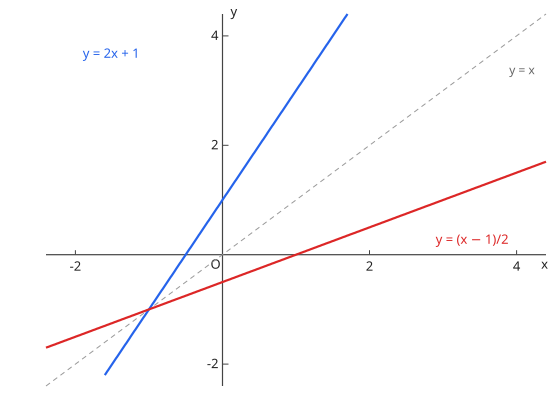

# 逆関数と合成関数

## 1. 逆関数

原函数须单调（在指定区间上）才有反函数。求法：$y = f(x)$ 解出 $x = g(y)$ 再交换 $x, y$。原函数与反函数图像关于直线 $y = x$ 对称，定义域与值域互换。

图：$y = x^2$（$x \ge 0$，蓝）与其逆函数 $y = \sqrt{x}$（红）关于 $y = x$ 对称。

## 2. 合成関数

$(g \circ f)(x) = g(f(x))$，先内后外；一般不可交换。定义域需同时满足内层输出落在外层定义域内。

**演習：逆関数**

$f(x) = 2x - 3$ の逆関数を求めよ。

??? example "思路・解答"
    **答案**

    $f^{-1}(x) = \dfrac{x + 3}{2}$

    **思路**

    $y = 2x - 3$ 解出 $x = \dfrac{y + 3}{2}$，再交换文字。

    **解答**

    $$f^{-1}(x) = \frac{x + 3}{2}$$

**演習：合成関数**

$f(x) = x^2$、$g(x) = x + 1$ のとき、$(g \circ f)(2)$ と $(f \circ g)(2)$ を求めよ。

??? example "思路・解答"
    **答案**

    $(g \circ f)(2) = 5$、$(f \circ g)(2) = 9$

    **思路**

    先内层后外层：$(g \circ f)(2) = g(f(2)) = g(4) = 5$；反过来 $(f \circ g)(2) = f(g(2)) = f(3) = 9$。两者不同是常态。

    **解答**

    $$(g \circ f)(2) = 5, \qquad (f \circ g)(2) = 9$$

## 易错点

- [ ] 逆関数の存在条件（単調性）と定義域・値域の交換（求反函数先限定单调区间）
- [ ] 合成の順序（合成的顺序不可随意交换）
