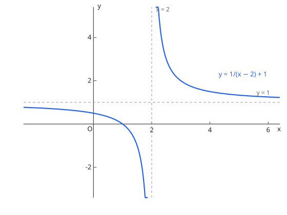
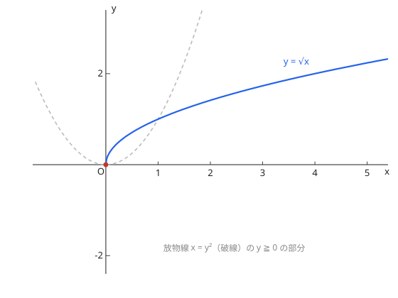

# 分数関数と無理関数

## 1. 分数関数

$y = \dfrac{k}{x - p} + q$ 是反比例 $y = \dfrac{k}{x}$ 平移后的双曲线，渐近线 $x = p$ 与 $y = q$，定义域 $x \ne p$、值域 $y \ne q$。一般分式先用除法把分子降次（帯分数化）再读渐近线。

图：$y = \dfrac{1}{x - 1} + 1$，漸近線 $x = 1$、$y = 1$。

## 2. 無理関数

$y = \sqrt{ax + b}$ 等：定义域由根号内 $\ge 0$ 决定，图像是抛物线的「半支」；$y = \sqrt{a - x^2}$ 类是半圆。先确认定义域再画图/求值域。

图：$y = \sqrt{x + 2}$，定义域 $x \ge -2$。

??? example "演習：分数関数の漸近線"
    **问题**

    $y = \dfrac{2x + 3}{x - 1}$ のグラフの漸近線を求めよ。

    **答案**

    $x = 1$ と $y = 2$

    **思路**

    带分数化：$\dfrac{2x + 3}{x - 1} = 2 + \dfrac{5}{x - 1}$。竖直渐近线在分母为 0 处，水平渐近线是带分数的整数部分。

    **解答**

    $$y = 2 + \frac{5}{x - 1} \quad\Longrightarrow\quad \text{漸近線 } x = 1,\ y = 2$$

## 易错点

- [ ] 無理関数の定義域（根号内 $\ge 0$）の確認を先に（先确认定义域再动手）

## 関連項目

- 基础：[指数関数・対数関数](../explog/exponent-extension.md)（指对互为反函数）
- 后续：[極限](../limits/sequence-limits.md)、[微分法](../differentiation/derivative-definition.md)
