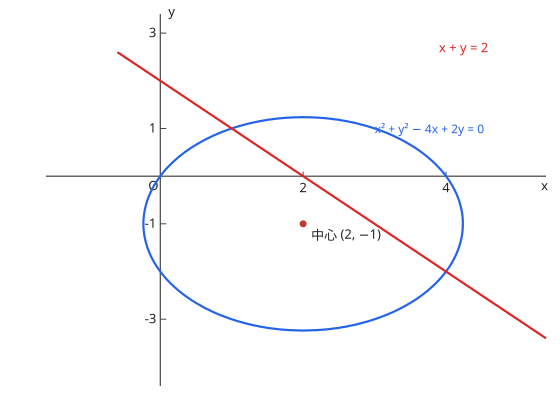

# 9. 図形と方程式

## シラバスとの対応

| 項目 | 内容 |
| --- | --- |
| 出題項目 | 9. 図形と方程式（数学II） |
| 細目 | (1) 点と直線：①点と直線の距離 ②直線の方程式 (2) 円：①円の方程式 ②円と直線 (3) 軌跡と領域：①軌跡 ②不等式と領域 |
| コース | コース2 のみ |

## 1. 点と直線

2 点 $(x_1, y_1)$, $(x_2, y_2)$ の間の距離は

$$
d = \sqrt{(x_2 - x_1)^2 + (y_2 - y_1)^2}
$$

線分 AB を $m:n$ に内分する点・外分する点は

$$
\left(\frac{nx_1 + mx_2}{m+n}, \frac{ny_1 + my_2}{m+n}\right), \qquad \left(\frac{-nx_1 + mx_2}{m-n}, \frac{-ny_1 + my_2}{m-n}\right)
$$

である。直線の方程式は、点 $(x_1, y_1)$ を通り傾き $m$ の直線 $y - y_1 = m(x - x_1)$、一般形 $ax + by + c = 0$ を使い分ける。点 $(x_1, y_1)$ と直線 $ax + by + c = 0$ の距離は

$$
d = \frac{|ax_1 + by_1 + c|}{\sqrt{a^2 + b^2}}
$$

2 直線の傾きを $m_1, m_2$ とすると、平行条件は $m_1 = m_2$、垂直条件は $m_1 m_2 = -1$ である。

## 2. 円の方程式

中心 $(a, b)$、半径 $r$ の円は

$$
(x - a)^2 + (y - b)^2 = r^2
$$

一般形 $x^2 + y^2 + ax + by + c = 0$ は、平方完成して中心 $\left(-\dfrac{a}{2}, -\dfrac{b}{2}\right)$、半径の 2 乗 $\dfrac{a^2}{4} + \dfrac{b^2}{4} - c$ を読み取る。**半径の 2 乗が正でなければ円にならない**（$0$ なら点円、負なら虚円）。

**円と直線の位置関係**：円の中心から直線までの距離を $d$、半径を $r$ とすると、$d < r$ で 2 点で交わり、$d = r$ で接し、$d > r$ で交わらない。接線は、中心から接点へ向かう半径と垂直である。

図：円 $x^2 + y^2 - 4x + 2y = 0$（中心 $(2, -1)$、半径 $\sqrt{5}$）と直線 $x + y = 2$（例題 1）。$d < r$ なので 2 点で交わる。

## 3. 軌跡と領域

軌跡を求める手順は 3 つである。(i) 求める点 P を $(x, y)$ と置く。(ii) 与えられた条件を $x, y$ の方程式に翻訳する。(iii) **その方程式を満たす点のうち、元の条件を満たさないものを除外する**（たとえば定点と一致する点）。

不等式の表す領域は、境界線上の 1 点を代入して、どちらの側が不等式を満たすかで決める。境界を含むときは実線、含まないときは破線で描く。連立不等式の表す領域は、各不等式の領域の共通部分である。

## 例題（演習）

!!! note "例題の扱いについて"
    本ページの例題は、真題の出題形式（穴埋め式）に合わせた自作の演習問題である。EJU の試験問題は JASSO の著作物のため本站には転載しない。真題そのものは [JASSO 公式の過去問題サンプル](https://www.jasso.go.jp/ryugaku/eju/examinee/pastpaper_sample/) で確認できる。

??? example "例題 1：円と直線の交点"
    円 $x^2 + y^2 - 4x + 2y = 0$ と直線 $x + y = 2$ の交点を求めよ。

    **考え方**：まず中心と直線の距離で交点の個数を確かめ、連立して座標を求める。

    **解答**：平方完成すると $(x - 2)^2 + (y + 1)^2 = 5$。中心 $(2, -1)$、半径 $\sqrt{5}$ で、中心と直線の距離は

    $$
    d = \frac{|2 - 1 - 2|}{\sqrt{2}} = \frac{1}{\sqrt{2}} < \sqrt{5}
    $$

    より 2 点で交わる。$y = 2 - x$ を円の方程式に代入すると $x^2 - 5x + 4 = 0$、すなわち $x = 1, 4$。

    **答え**：$(1, 1)$, $(4, -2)$

??? example "例題 2：アポロニウスの円"
    2 定点 A$(1, 0)$, B$(-1, 0)$ からの距離の比が $2:1$ である点 P の軌跡を求めよ。

    **考え方**：P$(x, y)$ と置き、条件 $\mathrm{PA} = 2\,\mathrm{PB}$ を座標の式にする。

    **解答**：両辺を 2 乗すると

    $$
    (x - 1)^2 + y^2 = 4\{(x + 1)^2 + y^2\}
    $$

    整理すると $3x^2 + 10x + 3 + 3y^2 = 0$、すなわち

    $$
    \left(x + \frac{5}{3}\right)^2 + y^2 = \frac{16}{9}
    $$

    **答え**：中心 $\left(-\dfrac{5}{3}, 0\right)$、半径 $\dfrac{4}{3}$ の円

??? example "例題 3：円の接線"
    点 $(0, 4)$ から円 $x^2 + y^2 = 4$ に引いた接線の方程式を求めよ。

    **考え方**：接線を $y = mx + 4$ と置き、中心からの距離が半径に等しいという条件で $m$ を決める。

    **解答**：中心 $(0, 0)$ から直線 $mx - y + 4 = 0$ までの距離が $2$ になるので

    $$
    \frac{|4|}{\sqrt{m^2 + 1}} = 2 \iff \sqrt{m^2 + 1} = 2 \iff m = \pm\sqrt{3}
    $$

    **答え**：$y = \sqrt{3}\,x + 4$, $y = -\sqrt{3}\,x + 4$

## よくあるミス

- [ ] 円の一般形を平方完成したとき、**半径の 2 乗が正であることを確認しない**
- [ ] 軌跡を求めた後、元の条件を満たさない点（定点と一致する点など）を除外し忘れる
- [ ] 接線を求めるとき、傾きが存在しない直線（$x = \text{一定}$）の場合を見落とす
- [ ] 領域を表す不等式で、境界を含むか含まないか（$\leqq$ と $<$）を取り違える
- [ ] 内分点と外分点の公式で、$m$ と $n$ の位置を逆にする

## 関連項目

- 基礎：[図形と計量](../course1/measure.md)（三角比・余弦定理は座標幾何の土台）
- 円と直線の関係は [三角関数](trig.md) の単位円ともつながる
- 2 次曲線への発展は [式と曲線](curves.md) へ
