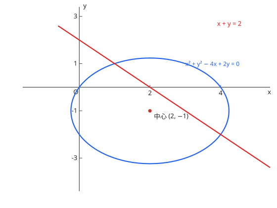

# 円と直線の関係

位置关系（相离/相切/相交）由圆心到直线的距离 $d$ 与 $r$ 比较，或联立后的判别式判定。弦长：$2\sqrt{r^2 - d^2}$。过圆上一点 $(x_1, y_1)$ 的切线：$x_1 x + y_1 y = r^2$（圆心在原点时）。

两个圆的公共弦（公共弦）：把两圆方程相减得到一条直线方程。

图：圆 $x^2 + y^2 = 4$ 与直线 $x = 1$，弦长 $2\sqrt{3}$。

??? example "演習：円と直線"
    **问题**

    円 $x^2 + y^2 = 4$ と直線 $x = 1$ の共有点の座標を求めよ。

    **答案**

    $(1, \sqrt{3})$ と $(1, -\sqrt{3})$

    **思路**

    把 $x = 1$ 代入圆的方程解 $y$；两个交点关于 $x$ 轴对称。

    **解答**

    $$1 + y^2 = 4 \quad\Longrightarrow\quad y^2 = 3 \quad\Longrightarrow\quad y = \pm\sqrt{3}$$

## 易错点

- [ ] 相切条件は $d = r$（或判别式 $= 0$），两种写法别混用一半
