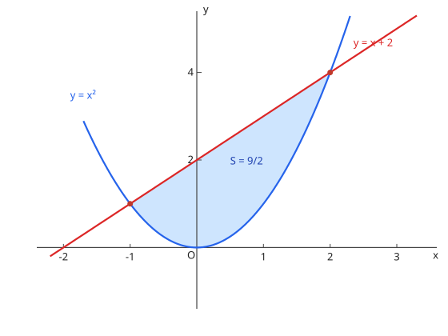

# 20. 積分法

## 与考纲的对应

| 项目 | 内容 |
| --- | --- |
| 考纲项目 | 20. 積分法（数学II・数学III） |
| 细目 | (1) 不定積分と定積分：①積分とその基本的な性質 ②置換積分法・部分積分法 ③様々な関数の積分　(2) 積分の応用：①面積 ②体積 ③曲線の長さ |
| 适用课程 | 仅 Course 2 |

## 1. 不定積分と定積分

$$
\int x^n\, dx = \frac{x^{n+1}}{n + 1} + C \ (n \ne -1), \qquad \int \frac{1}{x}\, dx = \log|x| + C, \qquad \int e^x\, dx = e^x + C, \qquad \int \cos x\, dx = \sin x + C, \qquad \int \sin x\, dx = -\cos x + C
$$

$$
\int_a^b f(x)\, dx = \left[F(x)\right]_a^b = F(b) - F(a) \qquad (F' = f)
$$

**置換積分法**（换元积分法）：令 $x = g(t)$，化成 $\int f(g(t))g'(t)\, dt$ 来算。定积分时积分区间也要跟着换。

**部分積分法**（分部积分法）：

$$
\int f(x)g'(x)\, dx = f(x)g(x) - \int f'(x)g(x)\, dx
$$

对「多项式 × 指数/三角函数」型的积最有效。选 $f$ 与 $g'$ 的原则是让右边的积分比原来更简单。

## 2. 面積・体積・曲線の長さ

两曲线围成的面积（$f \geqq g$）：$S = \displaystyle\int_a^b \{f(x) - g(x)\}\, dx$。上下关系在区间内交换时要分段。

图：$y = x^2$ 与 $y = x + 2$ 围成的部分（例题 3）。交点 $x = -1, 2$，面积 $\dfrac{9}{2}$。

绕 $x$ 轴的旋转体体积：$V = \pi \displaystyle\int_a^b \{f(x)\}^2\, dx$。

曲线 $y = f(x)$（$a \leqq x \leqq b$）的长度：

$$
L = \int_a^b \sqrt{1 + \{f'(x)\}^2}\, dx
$$

## 例题（演习）

??? example "例题 1：置換積分"
    $\displaystyle\int_0^1 x e^{x^2}\, dx$ を求めよ。

    **思路**：令 $t = x^2$，则 $dt = 2x\, dx$，区间变为 $t : 0 \to 1$。

    **解答**：$\displaystyle\int_0^1 \frac{1}{2} e^t\, dt = \frac{1}{2}\left[e^t\right]_0^1 = \frac{e - 1}{2}$。

    **答案**：$\dfrac{e - 1}{2}$

??? example "例题 2：部分積分"
    $\displaystyle\int_0^1 x e^x\, dx$ を求めよ。

    **思路**：取 $f(x) = x$、$g'(x) = e^x$ 用分部积分（$\int x e^x dx = (x - 1)e^x + C$）。

    **解答**：$\left[(x - 1)e^x\right]_0^1 = 0 \cdot e - (-1) \cdot 1 = 1$。

    **答案**：$1$

??? example "例题 3：面積"
    放物線 $y = x^2$ と直線 $y = x + 2$ で囲まれた部分の面積を求めよ。

    **思路**：先求交点，再用「上边的函数减下边的函数」积分。

    **解答**：交点由 $x^2 = x + 2$ 得 $x = -1, 2$。此区间内直线在上方：

    $$
    S = \int_{-1}^{2} (x + 2 - x^2)\, dx = \left[\frac{x^2}{2} + 2x - \frac{x^3}{3}\right]_{-1}^{2} = \frac{9}{2}
    $$

    **答案**：$\dfrac{9}{2}$

??? example "例题 4：曲線の長さ"
    曲線 $y = x^{\frac{3}{2}}$（$0 \leqq x \leqq 1$）の長さを求めよ。

    **思路**：把 $y' = \dfrac{3}{2}\sqrt{x}$ 代入长度公式，再用换元积分计算。

    **解答**：$1 + (y')^2 = 1 + \dfrac{9}{4}x$，所以

    $$
    L = \int_0^1 \sqrt{1 + \frac{9}{4}x}\, dx = \left[\frac{8}{27}\left(1 + \frac{9}{4}x\right)^{\frac{3}{2}}\right]_0^1 = \frac{13\sqrt{13} - 8}{27}
    $$

    **答案**：$\dfrac{13\sqrt{13} - 8}{27}$

## 易错点

- [ ] 定积分算出负数就直接当面积（面积要取绝对值或分段处理）
- [ ] 旋转体体积漏 $\pi$ 或漏平方
- [ ] 换元积分时定积分的区间忘记跟着换
- [ ] 分部积分选错 $f$ 与 $g'$，把积分越变越难

## 相关条目

- 上一个项目：[微分法](differentiation.md)（积分是微分的逆运算）
