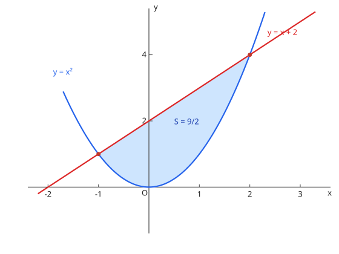

# 積分の応用

## 1. 面積

两曲线之间：$S = \int_a^b \left|f(x) - g(x)\right| dx$，先求交点定区间、判上下。曲线与 $y$ 轴围成时改用 $x$ 关于 $y$ 积分。

图：$y = x$ 与 $y = x^2$ 围成的面积 $\dfrac{1}{6}$（阴影）。

## 2. 体積

- 旋转体（绕 $x$ 轴）：$V = \pi \int_a^b \{f(x)\}^2 dx$；绕 $y$ 轴时换成 $x = g(y)$ 的形式
- 已知截面积 $S(x)$ 的立体：$V = \int_a^b S(x)\, dx$（バウムクーヘン法/円柱分割は上級手法として）

## 3. 曲線の長さ

$$L = \int_a^b \sqrt{1 + \left\{f'(x)\right\}^2}\, dx$$

参数形式 $L = \int \sqrt{\dot{x}^2 + \dot{y}^2}\, dt$；极坐标形式 $L = \int \sqrt{r^2 + (r')^2}\, d\theta$。

??? example "演習：面積"
    **问题**

    放物線 $y = x^2$ と直線 $y = x$ で囲まれた部分の面積を求めよ。

    **答案**

    $\dfrac{1}{6}$

    **思路**

    交点 $x = 0, 1$；在 $(0, 1)$ 内直线在上方（上图即此情形）。

    **解答**

    $$S = \int_0^1 (x - x^2)\, dx = \left[\frac{x^2}{2} - \frac{x^3}{3}\right]_0^1 = \frac{1}{2} - \frac{1}{3} = \frac{1}{6}$$

??? example "演習：回転体の体積"
    **问题**

    $y = \sqrt{x}$（$0 \le x \le 4$）と $x$ 軸で囲まれた部分を $x$ 軸のまわりに回転してできる立体の体積を求めよ。

    **答案**

    $8\pi$

    **思路**

    $V = \pi\int \{f(x)\}^2 dx$，$\{\sqrt{x}\}^2 = x$ 恰好简单。

    **解答**

    $$V = \pi \int_0^4 x\, dx = \pi \left[\frac{x^2}{2}\right]_0^4 = 8\pi$$

## 易错点

- [ ] 面積は「上－下」の符号付きでなく絶対値で積む（面积取上减下的正值，分段确认上下）
- [ ] 回転体の $\pi$ と $\{f(x)\}^2$ の付け忘れ（旋转体公式里的 π 与平方别漏）
- [ ] 曲線の長さの被積分関数の形（$\sqrt{1 + (f')^2}$ の形を正確に）
