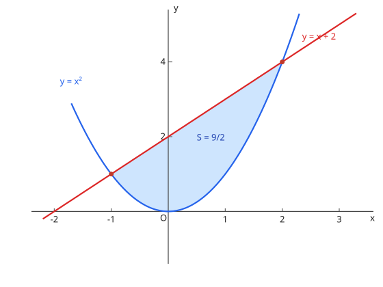

# 面積

两曲线之间：$S = \int_a^b \left|f(x) - g(x)\right| dx$，先求交点定区间、判上下。曲线与 $y$ 轴围成时改用 $x$ 关于 $y$ 积分。

图：$y = x$ 与 $y = x^2$ 围成的面积 $\dfrac{1}{6}$（阴影）。

**演習：面積**

放物線 $y = x^2$ と直線 $y = x$ で囲まれた部分の面積を求めよ。

??? example "思路・解答"
    **答案**

    $\dfrac{1}{6}$

    **思路**

    交点 $x = 0, 1$；在 $(0, 1)$ 内直线在上方（上图即此情形）。

    **解答**

    $$S = \int_0^1 (x - x^2)\, dx = \left[\frac{x^2}{2} - \frac{x^3}{3}\right]_0^1 = \frac{1}{2} - \frac{1}{3} = \frac{1}{6}$$

## 易错点

- [ ] 面積は「上－下」の符号付きでなく絶対値で積む（面积取上减下的正值，分段确认上下）
