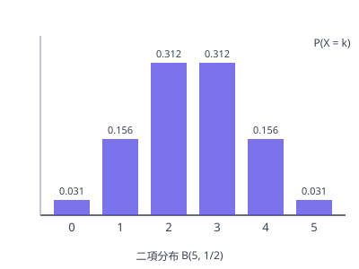

# 確率変数と確率分布

## 1. 確率変数と確率分布

**確率変数** とは、試行の結果に応じて値が定まる変数のことである（例：サイコロの出た目、コインを投げたときの表の回数）。通常 $X, Y$ のような大文字で表す。

確率変数 $X$ が値 $x_1, x_2, \dots, x_n$ をとり、それぞれの確率が $p_i = P(X = x_i)$ であるとき、この対応を表にしたものを $X$ の **確率分布** という。

| $X$ | $x_1$ | $x_2$ | $\cdots$ | $x_n$ | 計 |
| --- | --- | --- | --- | --- | --- |
| $P$ | $p_1$ | $p_2$ | $\cdots$ | $p_n$ | $1$ |

分布表を読むときの確認事項：

- 各確率は $0 \le p_i \le 1$ を満たす
- 確率の総和は $\displaystyle \sum_{i = 1}^{n} p_i = 1$（分布を作ったらまずこの検算をする）
- 区間の確率は該当する値の確率の和：$P(a \le X \le b)$ は $a \le x_i \le b$ となる $p_i$ の合計

## 2. 二項分布

图：二項分布 $B(5, \tfrac{1}{2})$ 的概率分布，左右对称、中间最高（各柱高度即 $P(X = k)$）。

成功確率 $p$ の試行を $n$ 回独立に繰り返し、成功回数を $X$ とすると、$X$ は **二項分布** $B(n, p)$ に従い、

$$P(X = k) = {}_n\mathrm{C}_k\, p^k (1 - p)^{n - k} \qquad (k = 0, 1, \dots, n)$$

となる（[反復試行の確率](../../course1/probability/independent-trials.md) の分布版である）。二項分布の特徴：

- 形は $np$ の近くに山があり、$n$ が大きいほど山の周りに集中する
- 期待値と分散は $E(X) = np$、$V(X) = np(1 - p)$ で与えられる（導出と使い方は [期待値・分散・標準偏差](moments.md)）
- 使える条件は「各試行が独立」「成功確率 $p$ が毎回一定」の2つ。試行のたびに $p$ が変わる場合は二項分布にはならない

## 3. 連続型の確率変数

$X$ が区間内のすべての実数値をとりうる場合を連続型という。このとき個別の値の確率は $P(X = a) = 0$ であり、確率は **確率密度関数** $f(x)$ を用いて面積で与えられる：

$$P(a \le X \le b) = \int_a^b f(x)\, dx, \qquad f(x) \ge 0, \quad \int_{-\infty}^{\infty} f(x)\, dx = 1$$

EJU の範囲では離散型が中心であり、連続型は概念の理解までにとどまる。

## 易错点

- [ ] 確率の総和が1になるかの検算を省く（列完分布后先验概率总和是否为 1）
- [ ] 二項分布の適用条件を確認しない（独立性と成功確率が一定であること）
- [ ] 連続型で $P(X = a) > 0$ だと思い込む（連続型では1点の確率は 0；区間で考える）
- [ ] 分布表で $P(a \le X \le b)$ に端の外の確率まで含める（該当する $x_i$ の確率だけを足す）
