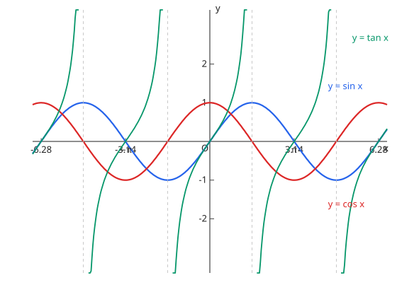

# 11. 三角関数

## 与考纲的对应

| 项目 | 内容 |
| --- | --- |
| 考纲项目 | 11. 三角関数（数学II） |
| 细目 | (1) 三角関数：①一般角と弧度法 ②三角関数とその基本的な性質 ③三角関数とそのグラフ　(2) 加法定理：①三角関数の加法定理 ②加法定理の応用 ③三角関数の合成 |
| 适用课程 | 仅 Course 2，是 [図形と計量](../course1/measure.md) 的推广 |

## 1. 一般角と弧度法

弧度法中 $\theta\ [\mathrm{rad}]$，$180^\circ = \pi$。半径 $r$、圆心角 $\theta$ 的扇形，弧长 $l = r\theta$，面积 $S = \dfrac{1}{2}r^2\theta$。

$y = \sin x$ 的周期是 $2\pi$，$y = \tan x$ 的周期是 $\pi$。$y = a \sin(bx + c) + d$ 的振幅是 $|a|$，周期是 $\dfrac{2\pi}{|b|}$。

图：$y = \sin x$、$y = \cos x$、$y = \tan x$ 的图像。$\tan x$ 在 $x = \dfrac{\pi}{2} + n\pi$ 处有渐近线。

## 2. 加法定理とその応用

$$
\sin(\alpha \pm \beta) = \sin\alpha\cos\beta \pm \cos\alpha\sin\beta, \qquad \cos(\alpha \pm \beta) = \cos\alpha\cos\beta \mp \sin\alpha\sin\beta
$$

$$
\tan(\alpha \pm \beta) = \frac{\tan\alpha \pm \tan\beta}{1 \mp \tan\alpha\tan\beta}
$$

**2倍角**（二倍角公式）：$\sin 2\alpha = 2\sin\alpha\cos\alpha$、$\cos 2\alpha = \cos^2\alpha - \sin^2\alpha = 1 - 2\sin^2\alpha = 2\cos^2\alpha - 1$。

**半角**（半角公式）：$\sin^2 \dfrac{\alpha}{2} = \dfrac{1 - \cos\alpha}{2}$、$\cos^2 \dfrac{\alpha}{2} = \dfrac{1 + \cos\alpha}{2}$。

**積和・和積**（积化和差 / 和差化积，要点）：$\sin\alpha\cos\beta = \dfrac{1}{2}\{\sin(\alpha + \beta) + \sin(\alpha - \beta)\}$、$\sin\alpha + \sin\beta = 2\sin\dfrac{\alpha + \beta}{2}\cos\dfrac{\alpha - \beta}{2}$。

符号规律记一句：sin 同号、cos 反号——加法定理的中间符号，$\sin$ 与左边的 $\pm$ 相同，$\cos$ 相反。

## 3. 三角関数の合成

$$
a\sin\theta + b\cos\theta = \sqrt{a^2 + b^2}\, \sin(\theta + \varphi), \qquad \cos\varphi = \frac{a}{\sqrt{a^2 + b^2}},\ \sin\varphi = \frac{b}{\sqrt{a^2 + b^2}}
$$

求最大值、最小值的问题，原则都是先合成成一个 $\sin$ 再读值域，$\varphi$ 要由 $\cos\varphi$ 与 $\sin\varphi$ 两个值共同确定，不能猜。

## 例题（演习）

??? example "例题 1：加法定理で値を求める"
    $\sin 75^\circ$ の値を求めよ。

    **思路**：把 $75^\circ$ 拆成 $45^\circ + 30^\circ$，用加法定理。

    **解答**：$\sin 75^\circ = \sin 45^\circ \cos 30^\circ + \cos 45^\circ \sin 30^\circ = \dfrac{\sqrt{2}}{2} \cdot \dfrac{\sqrt{3}}{2} + \dfrac{\sqrt{2}}{2} \cdot \dfrac{1}{2} = \dfrac{\sqrt{6} + \sqrt{2}}{4}$。

    **答案**：$\dfrac{\sqrt{6} + \sqrt{2}}{4}$

??? example "例题 2：合成と最大値"
    $f(\theta) = \sin\theta + \sqrt{3}\cos\theta$ の最大値と、そのときの $\theta$（$0 \leqq \theta < 2\pi$）を求めよ。

    **思路**：合成得 $f(\theta) = 2\sin\left(\theta + \dfrac{\pi}{3}\right)$，再读最大值。

    **解答**：最大值是 $2$。当 $\theta + \dfrac{\pi}{3} = \dfrac{\pi}{2}$，即 $\theta = \dfrac{\pi}{6}$ 时取到。

    **答案**：最大値 $2$（$\theta = \dfrac{\pi}{6}$）

??? example "例题 3：三角方程式"
    $0 \leqq x < 2\pi$ の範囲で $\sin 2x = \sin x$ を解け。

    **思路**：用二倍角公式展开左边，提取公因子 $\sin x$。

    **解答**：$2\sin x \cos x - \sin x = \sin x (2\cos x - 1) = 0$。由 $\sin x = 0$ 得 $x = 0, \pi$；由 $\cos x = \dfrac{1}{2}$ 得 $x = \dfrac{\pi}{3}, \dfrac{5\pi}{3}$。

    **答案**：$x = 0, \dfrac{\pi}{3}, \pi, \dfrac{5\pi}{3}$

## 易错点

- [ ] 加法定理符号记反（sin 同号、cos 反号）
- [ ] 方程的解在给定范围内列不全（周期性决定必须逐个核对范围）
- [ ] 合成的角度 $\varphi$ 靠猜（要由 $\cos\varphi$、$\sin\varphi$ 两式定）
- [ ] 弧度法与度数法混用

## 相关条目

- 基础：[図形と計量](../course1/measure.md)
- 求导后的形态见 [微分法](differentiation.md)
