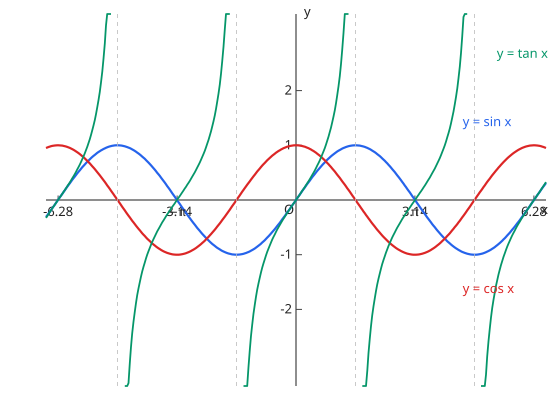

# 三角関数

## 1. 一般角と弧度法

弧度（ラジアン）：$\pi\ \mathrm{rad} = 180^\circ$；弧长 $l = r\theta$、扇形面积 $S = \dfrac{1}{2}r^2\theta$。

## 2. 基本的な性質

单位圆定义 $\sin\theta = y$、$\cos\theta = x$、$\tan\theta = \dfrac{y}{x}$。周期性：$\sin(\theta + 2\pi) = \sin\theta$ 等；诱导公式由单位圆的对称性推导（$\sin(\pi - \theta) = \sin\theta$、$\cos(\pi - \theta) = -\cos\theta$、$\sin\left(\dfrac{\pi}{2} - \theta\right) = \cos\theta$ 等）。相互关系 $\sin^2\theta + \cos^2\theta = 1$ 照常成立。

## 3. 三角関数とそのグラフ

- $y = \sin x$：周期 $2\pi$，值域 $[-1, 1]$，奇函数
- $y = \cos x$：周期 $2\pi$，值域 $[-1, 1]$，偶函数（是 $\sin$ 左移 $\dfrac{\pi}{2}$）
- $y = \tan x$：周期 $\pi$，渐近线 $x = \dfrac{\pi}{2} + n\pi$
- $y = a\sin(bx + c) + d$：振幅 $|a|$、周期 $\dfrac{2\pi}{b}$、相位平移 $-\dfrac{c}{b}$

图：$y = \sin x$、$y = \cos x$ 与 $y = \tan x$（$	an$ 在 $x = \pm\dfrac{\pi}{2}$ 处有渐近线）。

## 易错点

- [ ] 弧度法なのに度（°）の感覚で計算する（用了弧度制却按角度直觉计算）
- [ ] $\tan$ の周期は $\pi$（$\tan$ 的周期是 $\pi$ 不是 $2\pi$）
- [ ] $y = a\sin(bx + c)$ の周期は $2\pi / b$（周期看角速度 $b$，相位平移是 $-c/b$ 不是 $-c$）
