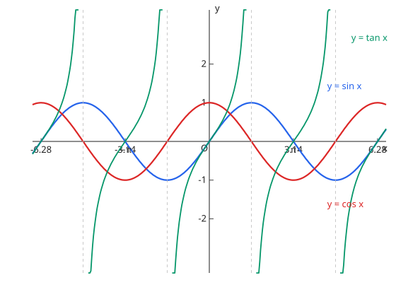

# 三角関数のグラフ

- $y = \sin x$：周期 $2\pi$，值域 $[-1, 1]$，奇函数
- $y = \cos x$：周期 $2\pi$，值域 $[-1, 1]$，偶函数（是 $\sin$ 左移 $\dfrac{\pi}{2}$）
- $y = \tan x$：周期 $\pi$，渐近线 $x = \dfrac{\pi}{2} + n\pi$
- $y = a\sin(bx + c) + d$：振幅 $|a|$、周期 $\dfrac{2\pi}{b}$、相位平移 $-\dfrac{c}{b}$

图：$y = \sin x$、$y = \cos x$ 与 $y = \tan x$（$\tan$ 在 $x = \pm\dfrac{\pi}{2}$ 处有渐近线）。

## 易错点

- [ ] $\tan$ の周期は $\pi$（$\tan$ 的周期是 $\pi$ 不是 $2\pi$）
- [ ] $y = a\sin(bx + c)$ の周期は $2\pi / b$（周期看角速度 $b$，相位平移是 $-c/b$ 不是 $-c$）
