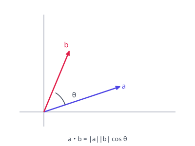

# ベクトルの内積

图：内积的几何含义——两向量夹角 $\theta$ 的余弦参与运算；$\theta = 90^\circ$ 时内积为 0。

$$\vec{a} \cdot \vec{b} = |\vec{a}||\vec{b}|\cos\theta = a_1 b_1 + a_2 b_2$$

垂直条件 $\vec{a} \cdot \vec{b} = 0$；夹角 $\cos\theta = \dfrac{\vec{a} \cdot \vec{b}}{|\vec{a}||\vec{b}|}$。内积为 0 是判定垂直最快的工具。

**演習：内積と角度**

$\vec{a} = (1, 0)$、$\vec{b} = (1, \sqrt{3})$ のなす角を求めよ。

??? example "思路・解答"
    **答案**

    $60^\circ$

    **思路**

    内积 $= 1$，模长 $|\vec{a}| = 1$、$|\vec{b}| = 2$，$\cos\theta = \dfrac{1}{2}$。

    **解答**

    $$\cos\theta = \frac{1}{1 \cdot 2} = \frac{1}{2} \quad\Longrightarrow\quad \theta = 60^\circ$$

## 易错点

- [ ] 内積が0＝垂直だが、$\vec{0}$ の扱い（零向量）には注意
