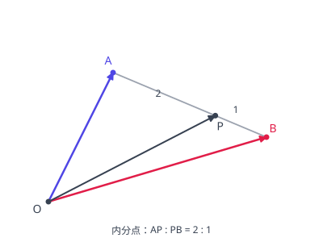

# 位置ベクトル

平面或空间中先取一个基准点 $O$（原点、基点），点 $P$ 的位置ベクトル就是 $\overrightarrow{OP}$，记作 $\vec{p}$。取定 $O$ 之后，**点与向量一一对应**，于是「点在直线上、点分线段的比」这类几何条件全部可以翻译成向量的代数运算。换基点时表示会变，所以做题第一步是声明基点取在哪里（常取某个顶点为 $O$，让该点的位置向量为 $\vec{0}$，式子最简）。

## 分点公式

线段 $AB$ 上两点的位置向量为 $\vec{a}$、$\vec{b}$ 时：

- 内分点：分 $AB$ 为 $m : n$ 的点 $\dfrac{n\vec{a} + m\vec{b}}{m + n}$（与坐标版同一形式）。权重是**交叉对应**：分点靠 $A$ 近（$m$ 小）时，$\vec{a}$ 的系数 $n$ 反而占大头——把它理解成「到两端的距离作反比加权」就不容易记反。

图：从原点 $O$ 出发的位置向量；$P$ 把 $AB$ 内分为 $2 : 1$，其位置向量是 $\dfrac{\vec{a} + 2\vec{b}}{3}$（越靠近谁，谁的权重越大）。
- 外分点：分 $AB$ 为 $m : n$（$m \ne n$）的点 $\dfrac{-n\vec{a} + m\vec{b}}{m - n}$。与内分式相比，$\vec{a}$ 的系数变号、分母变成 $m - n$，这是外分点落在线段延长线上的反映。
- 中点：$\dfrac{\vec{a} + \vec{b}}{2}$（内分 $1 : 1$ 的特例）。
- 重心：三角形 $ABC$ 的重心 $G$ 的位置向量 $\dfrac{\vec{a} + \vec{b} + \vec{c}}{3}$，即三个顶点位置向量的平均；重心分中线为 $2 : 1$，用中点公式代入即可验证。

## 共线条件

三点 $A$、$B$、$P$ 共线，当且仅当存在实数 $t$ 使 $\overrightarrow{AP} = t\overrightarrow{AB}$。用位置向量写出来（基点任意）：

$$\vec{p} = (1 - t)\vec{a} + t\vec{b}$$

即 $\vec{p} = s\vec{a} + u\vec{b}$ 且 $s + u = 1$。「系数和为 1」是共线判定的核心形式：看到某点写成两点位置向量的线性组合，先查系数和是不是 1。

## 共面条件（空间）

点 $P$ 在平面 $ABC$ 上，当且仅当 $\overrightarrow{AP} = s\overrightarrow{AB} + t\overrightarrow{AC}$。用位置向量写（基点任意）：

$$\vec{p} = s\vec{a} + t\vec{b} + u\vec{c}, \qquad s + t + u = 1$$

与共线条件一样，判定关键在「系数和为 1」。四点共面问题（见 [ベクトルと空間図形](space-figures.md)）的标准入口就是设法把第四点写成这个形式。

## 分点与面积比

同一高（高さが共通）的两个三角形，面积比等于底边比。由此：$D$ 在 $BC$ 上且 $BD : DC = m : n$ 时，$\triangle ABD : \triangle ADC = m : n$；中线把三角形面积二等分；重心与三个顶点连成的三个三角形面积相等。ベクトルで面積そのものを求める式は [ベクトルと図形](vector-figures.md) を参照。

## 易错点

- [ ] 内分点の重みを取り違える（内分点权重是"交叉对应"：分点离谁近，谁的坐标权重反而小，写完可用中点情形 $m = n$ 验算）
- [ ] 共線・共面条件の $s + t = 1$、$s + t + u = 1$ は基点をそろえて書いたときだけ使える（系数和条件只在同一基点下成立，中途换基点要全部重写）
- [ ] 外分点の分母は $m - n$（符号つき）で、$m = n$ のとき外分点は存在しない（外分比 $1:1$ 时无外分点，别硬套公式）
