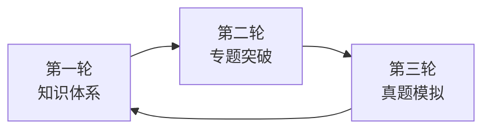

# 备考策略

## 三轮复习法

### 第一轮：建立知识树（4–6 周）

- 按本站目录顺序过知识点，每章完成"核心公式"默写；
- 不追求难题，目标是一轮后**看到题干能定位考点**。

### 第二轮：专题突破（3–4 周）

- 按错题归类，每个板块整理 5–10 道高频真题；
- 重点攻克 Course 1 的**整数的性质**、Course 2 的**微积分综合题**。

### 第三轮：真题限时模拟（考前 3 周）

- 严格 80 分钟计时，训练**日语审题速度**；
- 建立选项排除技巧：特殊值代入、端点检验、图像估算。

## 选择题实战技巧

!!! example "特殊值代入"
    判断恒等式或函数性质时，代入 $x=0, 1, -1$ 往往可排除 2–3 个选项。

!!! example "端点与极端化"
    概率、数列类题目可取 $n=1, 2$ 或面积趋于 0 的极端情形快速验证。

!!! warning "高频失分点"
    - 日语题干中的否定表达（〜ない、〜でない ものはどれか）读反；
    - 单位换算与"求的是哪个量"（$a$ 还是 $a^2$？）；
    - 答题卡填涂错位（EJU 答题卡为机器读卡，错位 = 0 分）。
