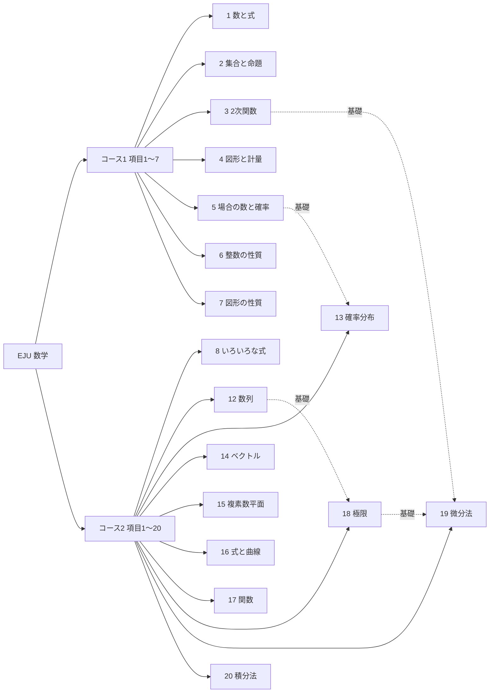

# EJU 数学知识库

**面向海外留学生的日本留学试验（EJU）数学系统化知识库**

组织方式参照 [OI Wiki](https://oi-wiki.org/)：考纲 → 知识点 → 公式 → 例题 → 易错点，层层推进。本站的语言分工是：**说明文字用中文，知识点与例题题面用日语**——因为考试本身是日语出题，术语和题面必须按日语原样熟悉；而讲解用中文，保证理解不打折。

---

## 这是什么

本站把 EJU 数学（Course 1 / Course 2）的全部出题范围整理为可检索、可互链的知识树。每个知识页遵循统一结构：

1. **与考纲的对应** —— JASSO 官方考纲的项目编号与细目（日语原文）；
2. **定义与公式** —— 知识点本体（日语，与日本教科书一致），配 KaTeX 公式；
3. **例题（演习）** —— 题面用日语（仿真题的穴埋め式），思路与解答讲解用中文；
4. **易错点** —— 高频失分点的中文整理。

出题范围与官方考纲的对照在 [出題範囲（シラバス）](exam/syllabus.md) 页（对应 JASSO 官方 syllabus，2026 年度第 1 回起施行）。注意：EJU 试题本身是 JASSO 的著作物，本站不转载真题题面；真题请到 JASSO 官方的过去问题样本页查看。

## 知识图谱

## 如何使用本站

- **第一轮学习**：按左侧目录顺序逐项推进，先把公式与术语（日语）过熟；
- **考前复习**：用顶部搜索框按公式关键词检索（如「判別式」「加法定理」）；
- **刷题阶段**：先遮住例题的解答自己做，再展开对照；题面是日语，先练读题速度。

## 记号约定

全站使用 LaTeX 记法。常用记号：

| 记号 | 含义 |
| --- | --- |
| $\mathbb{R},\ \mathbb{Z},\ \mathbb{N}$ | 实数集 / 整数集 / 自然数集 |
| $f'(x)$ | 导函数 |
| $\vec{a} \cdot \vec{b}$ | 向量内积 |
| $\varnothing$ | 空集 |
