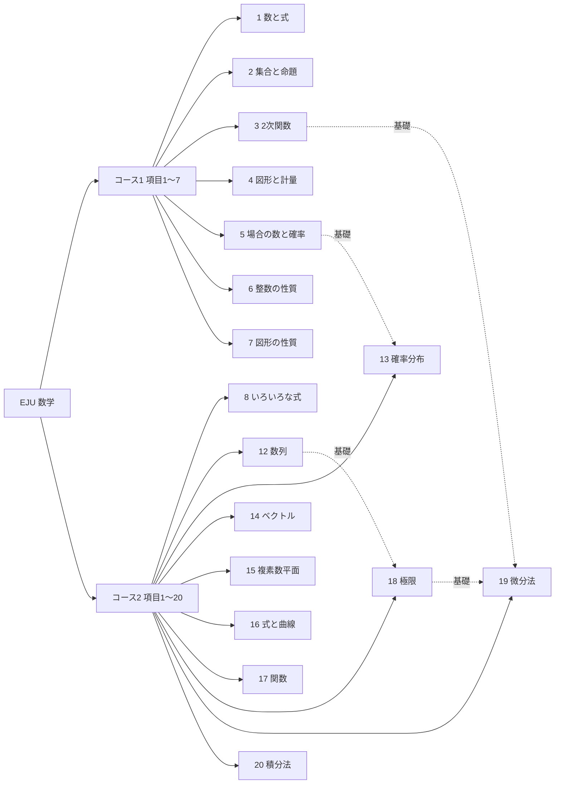

# EJU 数学知識庫

**日本留学試験（EJU）数学の体系的知識体系**

[OI Wiki](https://oi-wiki.org/) の組織方式を参照し、シラバス → 知識項目 → 公式 → 例題 → よくあるミスの順に積み上げた知識庫である。

---

## このサイトについて

EJU 数学（コース1 / コース2）の出題範囲のすべてを、検索・相互リンク可能な知識ツリーとして整理した。各項目のページは統一した構成を取る：

1. **シラバスとの対応** —— 公式シラバスの項目番号と細目；
2. **重要事項・定義と公式** —— KaTeX で表示する公式；
3. **例題（演習）** —— 穴埋め式の出題形式に合わせた自作の演習問題と、自作の解答；
4. **よくあるミス** —— 失点しやすいパターンの整理。

出題範囲は [出題範囲（シラバス）](exam/syllabus.md) のページに、JASSO 公式シラバス（2026 年度第 1 回から適用）との対照表としてまとめている。なお、EJU の試験問題自体は JASSO の著作物のため、本サイトには転載していない。真題は JASSO 公式の過去問題サンプルを参照されたい。

## 知識マップ

## 使い方

- **初回の学習**：左の目次を項目の順に進み、まず公式を確認する；
- **試験前の復習**：上の検索窓で公式のキーワード（「判別式」「加法定理」など）を検索する；
- **演習段階**：各ページのを、解答を隠して自分で解いてから確認する。

## 記号の約束

サイト全体で LaTeX 記法を使う。よく使う記号：

| 記号 | 意味 |
| --- | --- |
| $\mathbb{R},\ \mathbb{Z},\ \mathbb{N}$ | 実数 / 整数 / 自然数の集合 |
| $f'(x)$ | 導関数 |
| $\vec{a} \cdot \vec{b}$ | ベクトルの内積 |
| $\varnothing$ | 空集合 |
