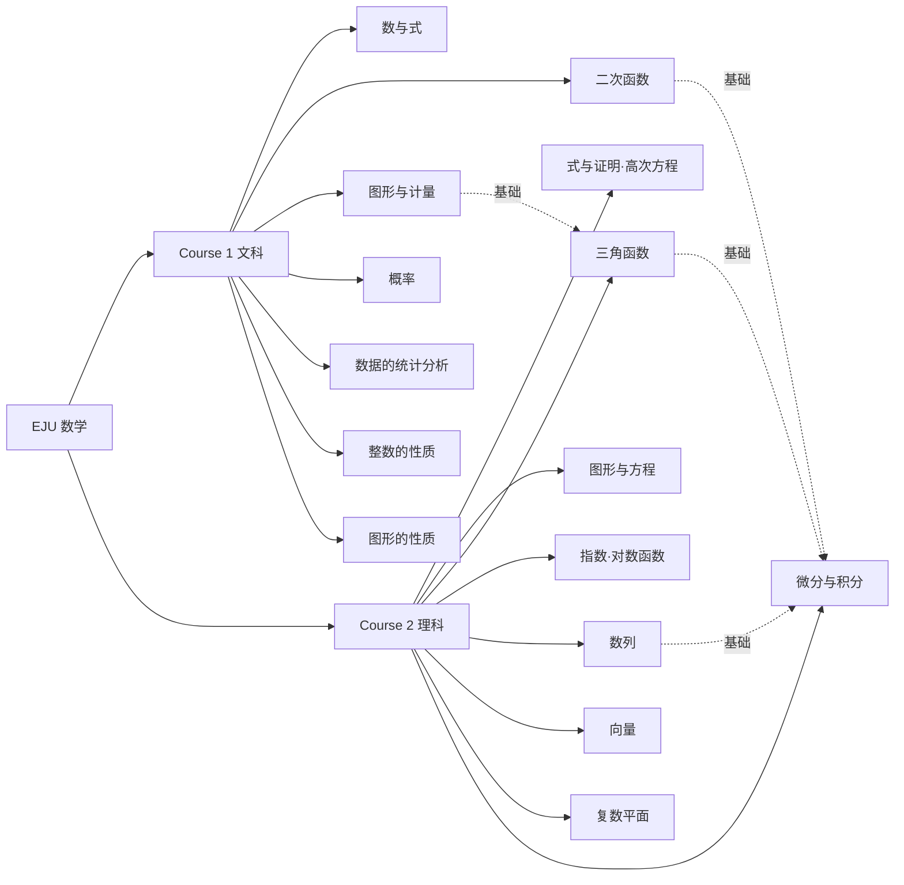

# EJU 数学知识库

**日本留学试验（EJU）数学系统化知识体系**

以 [OI Wiki](https://oi-wiki.org/) 的组织方式为参照：考纲 → 知识点 → 公式 → 例题 → 易错点，层层递进。

---

## 这是什么

本站将 EJU 数学（Course 1 文科数学 / Course 2 理科数学）的全部考纲知识点整理为可检索、可跳转的知识树。每个知识点页面遵循统一结构：

1. **考纲要求** —— 该考点在 EJU 中的考查形式与分值权重；
2. **核心公式** —— 用 KaTeX 渲染的公式速查；
3. **典型例题** —— 可折叠的例题与完整解答（仿照真题风格）；
4. **易错点与考场提示** —— 来自历年真题的高频失分点。

## 知识图谱

## 如何使用本站

- **首轮学习**：按左侧目录顺序过一遍知识点，重点看"核心公式"；
- **考前复习**：直接用顶部搜索框检索公式关键词（如"判别式""和差化积"）；
- **刷题阶段**：先看例题标签页中的【例题】，再展开【解答】自测。

## 公式约定

全站使用 LaTeX 记法。常用记号：

| 记号 | 含义 |
| --- | --- |
| $\mathbb{R},\ \mathbb{Z},\ \mathbb{N}$ | 实数集 / 整数集 / 自然数集 |
| $f'(x)$ | 导函数 |
| $\vec{a} \cdot \vec{b}$ | 向量内积 |
| $\varnothing$ | 空集 |
